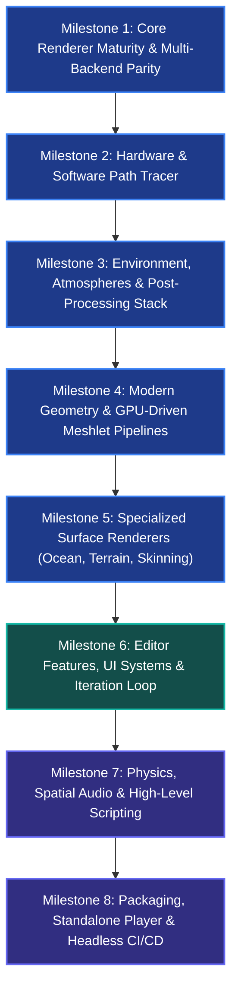

# Lyra Engine Roadmap

This document outlines the architectural structure of **Lyra Engine** and provides a comprehensive, low-level technical blueprint of milestones and tasks.

> [!IMPORTANT]
> **Priority Directive**: Graphics and rendering features take the highest precedence. Every rendering feature must have a corresponding **automated visual image test fixture** in `Tests/` with a golden `reference.png`, verified through perceptual regression testing ([`runtest.py`](file:///C:/Users/tcheng/source/repos/Lyra-Engine/Tools/Scripts/runtest.py), enforcing RMSE $\le 2.0$, mismatch $\le 1.0\%$, and per-channel noise tolerance $\le 2$).

---

## 1. Architectural Layout (`Engine` vs. `Modules`)

Lyra uses a modular, plugin-centric architecture:
- **`Engine/`**: Interface contracts, orchestration logic, and engine runtime.
- **`Modules/`**: Interchangeable plugins implementing the contracts defined by `Engine/`.

```
Lyra-Engine/
├── Engine/
│   ├── Include/Lyra/
│   │   ├── Assets/          # Asset Management System (AMS) interfaces, registry, watcher, formats
│   │   ├── Compiler/        # Shader compiler interfaces (SLCTypes)
│   │   ├── Components/      # ECS components (Mesh, Light, Sun, Camera, Transform, Audio, Physics...)
│   │   ├── FileSystem/      # Virtual File System (VFSPath, VFSTypes)
│   │   ├── Graphics/        # RHI definitions (GPUDevice, GPUBuffer, GPUTexture, GPUCommandEncoder...)
│   │   ├── InputSystem/     # Input state, bindings, and device management
│   │   ├── JobSystem/       # Task scheduler, worker threads, and parallel dispatch
│   │   ├── Rendering/       # Frame Graph, RenderWorld extraction, GeometryCache, Builtin Passes
│   │   ├── Runtime/         # Application loop, AppContext (Services + Blackboard), Layers
│   │   ├── Scene/           # SceneTree hierarchy, SceneManager, EnTT integration
│   │   ├── Scripting/       # Scripting context, registry, and command queues
│   │   ├── UISystem/        # UI layout abstractions, widget wrappers (Tree, Dock, Gizmo, Dialog)
│   │   ├── Utilities/       # Foundation types, containers, math, pointers, sync, coroutines, logging
│   │   └── Windowing/       # Window System Interface (WSI) types and contracts
│   ├── Source/              # Core engine library implementation (lyra-engine)
│   └── Assets/Shaders/      # Unified Slang shaders (BSDF, Atmosphere, Deferred, PathTracer, PostFX...)
│
└── Modules/
    ├── Assets/              # Cookers (glTF, OBJ, STL, DDS, KTX, EXR, Material, Mesh, Scene, Audio, Preview)
    ├── Compiler/            # Slang shader compiler, preprocessor, and reflection plugin
    ├── FileSystem/          # Native OS filesystem loader and PhysFS archive reader/packer
    ├── Graphics/            # RHI Backends: Vulkan, D3D12, Metal, SoftGPU (AVX2/Embree), MockGPU
    ├── Rendering/           # Renderers: Forward (Forward+), Deferred (Hybrid), GPUDriven, PathTracer
    ├── Scripting/           # Native & high-level scripting plugins (CameraControl, Lua/Luau)
    ├── UISystem/            # Dear ImGui backend, ImGuizmo integration, GUI Slang shader
    └── Windowing/           # GLFW desktop windowing backend
```

---

## 2. Master Milestone Roadmap (Reprioritized)



---

## 3. Low-Level Milestone Planning & Actionable Tasks

### Milestone 1: Core Renderer Maturity & Multi-Backend Parity (Highest Priority)
Goal: Solidify the primary rasterization pipelines (Forward+ and Deferred Hybrid) and establish perceptual visual image tests across Vulkan, SoftGPU, and D3D12.

#### 1.1 Deferred Hybrid Renderer & GBuffer
- [x] **1.1.1 GBuffer Multiple Render Target (MRT) Specification**
  - File: [`Engine/Source/Rendering/Passes/GBufferPass.cpp`](file:///C:/Users/tcheng/source/repos/Lyra-Engine/Engine/Source/Rendering/Passes/GBufferPass.cpp)
  - Shader: [`Engine/Assets/Shaders/GBuffer.slang`](file:///C:/Users/tcheng/source/repos/Lyra-Engine/Engine/Assets/Shaders/GBuffer.slang)
  - **Exact Render Target Formats & Channel Packing**:
    - **RT0 (`GPUTextureFormat::RGBA16UNORM`)**:
      - `RGB`: BaseColor in linear space.
      - `A`: Material Ambient Occlusion (AO / Occlusion factor) in $[0, 1]$.
    - **RT1 (`GPUTextureFormat::RGBA16SNORM`)**:
      - `RG`: Octahedral-encoded world-space normal vector $\vec{N} \in [-1, 1]$.
        $$\text{Decode: } \vec{v} = (x, y); \ z = 1.0 - |x| - |y|; \ \text{if } z < 0: \vec{v} = (1 - |y|, 1 - |x|) \odot \text{sign}(\vec{v}); \ \vec{N} = \text{normalize}(\vec{v}.x, \vec{v}.y, z)$$
      - `B`: Perceptual roughness $\alpha_{\text{roughness}} \in [0, 1]$.
      - `A`: Metallic factor in $[0, 1]$.
    - **RT2 (`GPUTextureFormat::RG11B10UFLOAT`)**:
      - Unsigned floating-point emissive radiance in $\text{W}/(\text{sr}\cdot\text{m}^2)$.
    - **RT3 (`GPUTextureFormat::RG8UINT`)**:
      - `R`: Shading Model ID (`0 = Unlit`, `1 = DefaultLit`, `2 = Clearcoat`, `3 = Subsurface`, `4 = Cloth`).
      - `G`: Quantized Clearcoat factor in $[0, 255]$ (or custom material parameters).
    - **Depth Target (`GPUTextureFormat::DEPTH32FLOAT`)**:
      - Reversed floating-point depth ($z_{\text{near}} = 1.0$, $z_{\text{far}} = 0.0$ at infinity) for maximized logarithmic precision.
- [x] **1.1.2 Clustered Light Culling Compute Pass**
  - Files: [`Engine/Source/Rendering/Passes/LightCullingPass.cpp`](file:///C:/Users/tcheng/source/repos/Lyra-Engine/Engine/Source/Rendering/Passes/LightCullingPass.cpp), [`Engine/Assets/Shaders/Forward/LightCulling.slang`](file:///C:/Users/tcheng/source/repos/Lyra-Engine/Engine/Assets/Shaders/Forward/LightCulling.slang)
  - **Tile Grid Discretization**:
    - Screen tile size: $16 \times 16$ pixels.
    - Depth slices: 24 exponential logarithmic clusters:
      $$k = \left\lfloor \frac{\log(z / z_{\text{near}})}{\log(z_{\text{far}} / z_{\text{near}})} \times 24 \right\rfloor$$
    - Compute threadgroup: `[numthreads(16, 16, 1)]` testing cluster bounding AABB against sphere lights ($d \le r$).
    - Output Buffers:
      - `LightGridSSBO`: `StructuredBuffer<uint2>` storing `(offset, count)` per 3D cluster $(x, y, z)$.
      - `LightIndexListSSBO`: `ByteAddressBuffer` storing contiguous 16-bit light indices.
- [x] **1.1.3 Deferred Lighting Resolve Pass**
  - File: [`Modules/Rendering/Deferred/DeferredRendererPlugin.cpp`](file:///C:/Users/tcheng/source/repos/Lyra-Engine/Modules/Rendering/Deferred/DeferredRendererPlugin.cpp)
  - Shader: [`Engine/Assets/Shaders/Deferred/DeferredLighting.slang`](file:///C:/Users/tcheng/source/repos/Lyra-Engine/Engine/Assets/Shaders/Deferred/DeferredLighting.slang)
  - Fullscreen compute or quad dispatch decoding GBuffer, fetching cluster light indices, evaluating standard Cook-Torrance GGX specular and Lambertian diffuse.
  - Cascaded Shadow Map (CSM) sampling: 4 splits computed with Practical Split Scheme ($\lambda = 0.85$), $4 \times 4$ PCF sampling with normal offset bias:
    $$\vec{x}_{\text{biased}} = \vec{x}_{\text{world}} + \vec{N} \cdot (\text{bias}_{\text{normal}} \cdot \text{texel\_size})$$
- [x] **1.1.4 Deferred Visual Regression Test Fixture**
  - Directory: `Tests/deferred_renderer_multilight/`
  - Scene Setup: Test chamber featuring 16 colored point lights with smooth distance falloff $f_{\text{att}} = \left(\text{saturate}\left(1 - (d/r)^4\right)\right)^2 / (d^2 + 1)$ (sunlight disabled to isolate local lights), and shadow-casting occluder pillars.
  - Image Verification: Compare rendered output against golden `reference.png` via [`runtest.py`](file:///C:/Users/tcheng/source/repos/Lyra-Engine/Tools/Scripts/runtest.py) ($\text{RMSE} \le 1.5$, $\text{mismatch} \le 0.5\%$).
  - Command: `just test deferred_renderer_multilight`.

#### 1.2 Forward+ Clustered Lighting Pipeline
- [x] **1.2.1 Forward+ Pass Execution**
  - File: [`Modules/Rendering/Forward/ForwardRenderer.cpp`](file:///C:/Users/tcheng/source/repos/Lyra-Engine/Modules/Rendering/Forward/ForwardRenderer.cpp)
  - Shader: [`Engine/Assets/Shaders/Forward/Forward.slang`](file:///C:/Users/tcheng/source/repos/Lyra-Engine/Engine/Assets/Shaders/Forward/Forward.slang)
  - Pass Order: Depth Prepass $\to$ Clustered Light Culling Compute $\to$ Forward Shading Pass with multi-light loop reading `LightGridSSBO`.
- [x] **1.2.2 Forward+ Visual Regression Test Fixture**
  - Directory: `Tests/forward_renderer_multilight/`
  - Scene Setup: Test chamber featuring 16 colored point lights with smooth distance falloff $f_{\text{att}} = \left(\text{saturate}\left(1 - (d/r)^4\right)\right)^2 / (d^2 + 1)$ (sunlight disabled to isolate local lights), matching `deferred_renderer_multilight`.
  - Image Verification: Compare rendered output against golden `reference.png` via [`runtest.py`](file:///C:/Users/tcheng/source/repos/Lyra-Engine/Tools/Scripts/runtest.py) ($\text{RMSE} \le 1.5$, $\text{mismatch} \le 0.5\%$).
  - Parity Assertion: Cross-compare rendered buffer of Forward+ with Deferred Hybrid resolve ($\text{RMSE} = 0.039$, 0 mismatch pixels between both pipelines).
  - Command: `just test forward_renderer_multilight`.

#### 1.3 Material & Shading Model Unification
- [x] **1.3.1 MaterialParams Memory Layout & Alignment**
  - Header: [`Engine/Include/Lyra/Rendering/MaterialParams.h`](file:///C:/Users/tcheng/source/repos/Lyra-Engine/Engine/Include/Lyra/Rendering/MaterialParams.h)
  - Shader: [`Engine/Assets/Shaders/Common/Material.slang`](file:///C:/Users/tcheng/source/repos/Lyra-Engine/Engine/Assets/Shaders/Common/Material.slang)
  - **16-Byte Aligned Struct (std140 / std430)**:
    ```cpp
    struct alignas(16) MaterialParams
    {
        Vector4       base_color           = Vector4(1.0f); // 16 bytes (offset 0)
        float         metallic             = 0.0f;          // 4 bytes  (offset 16)
        float         roughness            = 0.5f;          // 4 bytes  (offset 20)
        float         clear_coat           = 0.0f;          // 4 bytes  (offset 24)
        float         clear_coat_roughness = 0.04f;         // 4 bytes  (offset 28)
        Vector4       emissive             = Vector4(0.0f); // 16 bytes (offset 32)
        Vector4       custom_data          = Vector4(0.0f); // 16 bytes (offset 48) - SSS radius / cloth sheen / NPR
        uint          shading_model_id     = 0;             // 4 bytes  (offset 64)
        float         alpha_cutoff         = 0.5f;          // 4 bytes  (offset 68)
        MaterialFlags flags                = {};            // 4 bytes  (offset 72)
        uint          custom_params_offset = 0;             // 4 bytes  (offset 76)
    }; // Total size: 80 bytes (multiple of 16)
    ```
  - *Design refinement*: Replaced arbitrary `padding` at offset 76 with `custom_params_offset` to enable dynamic indexing into custom material parameter storage buffers.
  - Unit tests: [`Tests/material/material.cpp`](file:///C:/Users/tcheng/source/repos/Lyra-Engine/Tests/material/material.cpp).
- [x] **1.3.2 Shading Model Registry & Extensible Archetypes**
  - Header: [`Engine/Include/Lyra/Rendering/ShadingModelRegistry.h`](file:///C:/Users/tcheng/source/repos/Lyra-Engine/Engine/Include/Lyra/Rendering/ShadingModelRegistry.h)
  - File: [`Engine/Source/Rendering/ShadingModelRegistry.cpp`](file:///C:/Users/tcheng/source/repos/Lyra-Engine/Engine/Source/Rendering/ShadingModelRegistry.cpp)
  - Shaders: [`Engine/Assets/Shaders/Common/ShadingModel.slang`](file:///C:/Users/tcheng/source/repos/Lyra-Engine/Engine/Assets/Shaders/Common/ShadingModel.slang), [`Engine/Assets/Shaders/Shading/BuiltinShading.slang`](file:///C:/Users/tcheng/source/repos/Lyra-Engine/Engine/Assets/Shaders/Shading/BuiltinShading.slang)
  - *Design refinement*: Elevated built-in models and custom user-defined models into first-class citizens registered via `ShadingModelInfo` (`id`, `name`, `shader_module_path`, `entry_point_name`, `struct_name`) conforming to Slang `interface IShadingModel`:
    - `Standard` (`0x1001`): GGX specular + Smith masking-shadowing $G_2$ + Schlick Fresnel (`fs_standard`).
    - `Clearcoat` (`0x1002`): Dual-specular lobe with uncoupled clearcoat layer (`fs_clearcoat`).
    - `Subsurface` (`0x1003`): Diffuse scattering profile for organic / translucent media (`fs_subsurface`).
    - `Unlit` (`0x1004`): Direct emissive color passthrough (`fs_unlit`).
  - Unit tests: [`Tests/rendering/test_shading_model_mesh_pass.cpp`](file:///C:/Users/tcheng/source/repos/Lyra-Engine/Tests/rendering/test_shading_model_mesh_pass.cpp).
- [x] **1.3.3 Shading Model Visual Test Fixture**
  - Directory: [`Tests/shading_models/`](file:///C:/Users/tcheng/source/repos/Lyra-Engine/Tests/shading_models/)
  - Render a $4 \times 4$ sphere matrix: Roughness $[0.05, 0.95]$, Metallic $[0.0, 1.0]$, Clearcoat, and Subsurface scattering. Verify image against golden `reference.png`.
  - Validate with `just test shading_models` (verified passing on Vulkan, Metal, SoftGPU).

#### 1.4 Multi-Backend RHI Parity
- [ ] **1.4.1 Vulkan & SoftGPU Visual Parity**
  - Run `just test rhi-tests` comparing frame captures between hardware Vulkan and CPU SoftGPU (AVX2 rasterizer).
- [ ] **1.4.2 D3D12 Backend Parity Audit**
  - Directory: [`Modules/Graphics/D3D12/`](file:///C:/Users/tcheng/source/repos/Lyra-Engine/Modules/Graphics/D3D12)
  - Verify root signatures, descriptor heaps, and pipeline state objects correctly handle Slang DXIL bytecode; run test fixtures with `--gfxapi d3d12`.

---

### Milestone 2: Hardware & Software Path Tracer (Highest Priority)
Goal: Complete the reference path tracer in `Modules/Rendering/PathTracer`, supporting hardware DXR/Vulkan ray tracing with fallback to SoftGPU Embree, verified by progressive image testing.

#### 2.1 Ray Tracing Pipeline & Acceleration Structures
- [ ] **2.1.1 Ray Tracing Pipeline & Shader Binding Table (SBT)**
  - File: [`Modules/Rendering/PathTracer/PathTracerRendererPlugin.cpp`](file:///C:/Users/tcheng/source/repos/Lyra-Engine/Modules/Rendering/PathTracer/PathTracerRendererPlugin.cpp)
  - Shader: [`Engine/Assets/Shaders/PathTracer/PathTracer.slang`](file:///C:/Users/tcheng/source/repos/Lyra-Engine/Engine/Assets/Shaders/PathTracer/PathTracer.slang)
  - Compile RayGen (`raygen_main`), ClosestHit (`closesthit_main`), and Miss (`miss_main`) shaders into `GPURayTracingPipeline`.
  - **Shader Binding Table (SBT) Layout**:
    - `RaygenTable`: 1 record (32-byte shader identifier + 32-byte camera uniform descriptor).
    - `MissTable`: 2 records (Record 0 = Radiance miss / Atmosphere sky; Record 1 = Shadow ray miss).
    - `HitGroupTable`: $N$ records (64 bytes aligned per geometry instance, storing vertex/index buffer device addresses and material index).
- [ ] **2.1.2 Dynamic TLAS Construction in FrameGraph**
  - Files: [`Engine/Source/Rendering/RenderWorld.cpp`](file:///C:/Users/tcheng/source/repos/Lyra-Engine/Engine/Source/Rendering/RenderWorld.cpp), [`Modules/Graphics/Vulkan/VkTlas.cpp`](file:///C:/Users/tcheng/source/repos/Lyra-Engine/Modules/Graphics/Vulkan/VkTlas.cpp)
  - Extract `GPUBlasHandle` instances and build Top-Level Acceleration Structure via `vkCmdBuildAccelerationStructuresKHR` on Vulkan, or `BuildRaytracingAccelerationStructure` on D3D12.
- [ ] **2.1.3 SoftGPU Embree CPU Fallback**
  - Library: Intel Embree 4.x (linked via `vcpkg`)
  - File: [`Modules/Graphics/SoftGPU/`](file:///C:/Users/tcheng/source/repos/Lyra-Engine/Modules/Graphics/SoftGPU)
  - Implement software ray tracing fallback via `rtcNewGeometry`, `rtcCommitScene`, `rtcIntersect1`, and `rtcOccluded1`.

#### 2.2 Monte Carlo Multi-Bounce Global Illumination
- [ ] **2.2.1 Multi-Bounce Path Integration & Russian Roulette**
  - Shaders: [`Engine/Assets/Shaders/PathTracer/PathTracer.slang`](file:///C:/Users/tcheng/source/repos/Lyra-Engine/Engine/Assets/Shaders/PathTracer/PathTracer.slang), [`Engine/Assets/Shaders/Common/RayTracing.slang`](file:///C:/Users/tcheng/source/repos/Lyra-Engine/Engine/Assets/Shaders/Common/RayTracing.slang)
  - Loop depth: Up to 16 bounces.
  - Russian Roulette path termination based on throughput $\beta$:
    $$q = \min\left(0.95, \max(\beta_r, \beta_g, \beta_b)\right); \quad \text{if } \xi > q \implies \text{terminate}; \quad \text{else } \beta \leftarrow \frac{\beta}{q}$$
  - Ray Cone propagation for mip level texture filtering:
    $$\text{cone.width}' = \text{cone.width} + 2 \cdot t \cdot \tan\left(\frac{\text{cone.spread}}{2}\right)$$
- [ ] **2.2.2 BSDF Importance Sampling & Next-Event Estimation (NEE)**
  - Shaders: [`Engine/Assets/Shaders/Common/BSDF.slang`](file:///C:/Users/tcheng/source/repos/Lyra-Engine/Engine/Assets/Shaders/Common/BSDF.slang), [`Engine/Assets/Shaders/Common/Sampling.slang`](file:///C:/Users/tcheng/source/repos/Lyra-Engine/Engine/Assets/Shaders/Common/Sampling.slang)
  - **Diffuse Lobe**: Cosine-weighted hemisphere sampling:
    $$\vec{\omega}_i = \left(\cos\phi\sqrt{\xi_1}, \ \sin\phi\sqrt{\xi_1}, \ \sqrt{1 - \xi_1}\right), \quad \text{PDF} = \frac{\vec{N} \cdot \vec{\omega}_i}{\pi}$$
  - **Specular Lobe**: GGX Visible Normal Distribution Function (VNDF) sampling (Eric Heitz formulation), avoiding invalid back-facing samples.
  - **Next-Event Estimation (NEE)**: Trace shadow rays towards analytical lights; combine direct sampling with BSDF sampling using the Multiple Importance Sampling (MIS) balance/power heuristic ($\beta = 2$):
    $$w_{\text{NEE}} = \frac{p_{\text{light}}^2}{p_{\text{light}}^2 + p_{\text{BSDF}}^2}$$

#### 2.3 Temporal Accumulation & Spatio-Temporal Denoising (SVGF)
- [ ] **2.3.1 RGBA32F Progressive Accumulation**
  - File: [`Modules/Rendering/PathTracer/PathTracerRendererPlugin.cpp`](file:///C:/Users/tcheng/source/repos/Lyra-Engine/Modules/Rendering/PathTracer/PathTracerRendererPlugin.cpp)
  - Allocate high-precision temporal buffer (`GPUTextureFormat::RGBA32FLOAT`).
  - Generate 2D sub-pixel camera jitter using Halton sequence bases $(2, 3)$.
  - Stationary accumulation recurrence:
    $$C_{\text{accum}}(N) = \frac{N - 1}{N} C_{\text{accum}}(N - 1) + \frac{1}{N} C_{\text{current}}$$
  - Automatically reset $N \leftarrow 0$ when camera matrix or entity transform changes.
- [ ] **2.3.2 Wavelet Denoising Pass (A-Trous / SVGF)**
  - Shader: [`Engine/Assets/Shaders/Common/Denoising.slang`](file:///C:/Users/tcheng/source/repos/Lyra-Engine/Engine/Assets/Shaders/Common/Denoising.slang)
  - 5-iteration A-Trous filter with $2^i$ step dilation ($i \in [0, 4]$) and $5 \times 5$ $B$-spline kernel:
    $$w(p, q) = w_z(p, q) \cdot w_n(p, q) \cdot w_l(p, q)$$
    - Depth Weight: $w_z = \exp\left(-\frac{|z_p - z_q|}{\sigma_z |\nabla z \cdot (p - q)| + \epsilon}\right)$ ($\sigma_z = 1.0$).
    - Normal Weight: $w_n = \max(0, \vec{n}_p \cdot \vec{n}_q)^{\sigma_n}$ ($\sigma_n = 128.0$).
    - Luminance Weight: $w_l = \exp\left(-\frac{|l_p - l_q|}{\sigma_l \sqrt{\text{Var}(l_p)} + \epsilon}\right)$ in YCoCg space ($\sigma_l = 4.0$).

#### 2.4 Path Tracer Visual Image Test Fixture
- [ ] **2.4.1 Cornell Box Path Tracer Visual Test**
  - Directory: `Tests/path_tracer/`
  - Scene Setup: Classic Cornell Box (diffuse red/green walls, diffuse white floor/ceiling, 1 mirror metallic sphere, 1 glass dielectric sphere, 1 quad area light).
  - Test Execution: Render 128 accumulated SPP; run A-Trous denoiser; compare output against golden `reference.png` across Vulkan DXR and SoftGPU Embree backends.
  - Validate with `just test path_tracer` ($\text{RMSE} \le 2.0$, $\text{mismatch} \le 1.0\%$).

---

### Milestone 3: Environment, Atmospheres & Post-Processing Stack (High Priority)
Goal: Hook up the existing environment and post-processing Slang shaders into the FrameGraph for high-fidelity lighting and camera effects, accompanied by visual verification.

#### 3.1 Physical Sky, Atmosphere & Image-Based Lighting (IBL)
- [x] **3.1.1 Bruneton Precomputed Atmospheric Scattering**
  - Shader: [`Engine/Assets/Shaders/Sky/Atmosphere.slang`](file:///C:/Users/tcheng/source/repos/Lyra-Engine/Engine/Assets/Shaders/Sky/Atmosphere.slang)
  - Pass: [`Engine/Source/Rendering/Passes/SkyboxPass.cpp`](file:///C:/Users/tcheng/source/repos/Lyra-Engine/Engine/Source/Rendering/Passes/SkyboxPass.cpp)
  - Planetary Constants: Earth radius $R_p = 6360\,\text{km}$, top of atmosphere $R_a = 6420\,\text{km}$.
  - Rayleigh Scattering: $\beta_R = (5.802, 13.558, 33.1) \times 10^{-6}\,\text{m}^{-1}$, scale height $H_R = 8.0\,\text{km}$.
  - Mie Scattering: $\beta_M = 3.996 \times 10^{-6}\,\text{m}^{-1}$, scale height $H_M = 1.2\,\text{km}$, asymmetry $g = 0.8$.
  - Ozone Absorption: $\beta_{\text{ozone}} = (0.650, 1.881, 0.085) \times 10^{-6}\,\text{m}^{-1}$, peak altitude $25\,\text{km}$.
  - Precompute 3 LUTs:
    1. `TransmittanceLUT` ($256 \times 64$, optical depth & solar beam transmittance, [`AtmosphereTransmittanceLUT.slang`](file:///C:/Users/tcheng/source/repos/Lyra-Engine/Engine/Assets/Shaders/Sky/AtmosphereTransmittanceLUT.slang)).
    2. `MultiScatteringLUT` ($32 \times 32$, 2nd-order scattering energy conservation, [`AtmosphereMultiScatterLUT.slang`](file:///C:/Users/tcheng/source/repos/Lyra-Engine/Engine/Assets/Shaders/Sky/AtmosphereMultiScatterLUT.slang)).
    3. `SkyViewLUT` ($192 \times 108$, spherical coordinates $(\theta, \phi)$, [`AtmosphereSkyViewLUT.slang`](file:///C:/Users/tcheng/source/repos/Lyra-Engine/Engine/Assets/Shaders/Sky/AtmosphereSkyViewLUT.slang)).
  - Synchronize dynamically with `SunComponent` and `DirectionalLight` direction and intensity.
  - Test Fixture: [`Tests/atmosphere/`](file:///C:/Users/tcheng/source/repos/Lyra-Engine/Tests/atmosphere/) (`just test atmosphere` verified passing on Vulkan, Metal, SoftGPU).
- [x] **3.1.2 HDR Environment Map Cooker & Split-Sum IBL Integration**
  - Shaders: [`Engine/Assets/Shaders/LUT/BRDFLut.slang`](file:///C:/Users/tcheng/source/repos/Lyra-Engine/Engine/Assets/Shaders/LUT/BRDFLut.slang), [`Engine/Assets/Shaders/Common/SphericalHarmonics.slang`](file:///C:/Users/tcheng/source/repos/Lyra-Engine/Engine/Assets/Shaders/Common/SphericalHarmonics.slang), [`Forward.slang`](file:///C:/Users/tcheng/source/repos/Lyra-Engine/Engine/Assets/Shaders/Forward/Forward.slang), [`DeferredLighting.slang`](file:///C:/Users/tcheng/source/repos/Lyra-Engine/Engine/Assets/Shaders/Deferred/DeferredLighting.slang)
  - Cooker Module: [`Modules/Assets/Texture/IBLCooker.h`](file:///C:/Users/tcheng/source/repos/Lyra-Engine/Modules/Assets/Texture/IBLCooker.h), [`IBLCooker.cpp`](file:///C:/Users/tcheng/source/repos/Lyra-Engine/Modules/Assets/Texture/IBLCooker.cpp), integrated into `STBCookerPlugin` and `EXRCookerPlugin`.
  - **Cooker Tasks**:
    - Precompute 2D GGX Split-Sum BRDF LUT ($512 \times 512$, `RGBA16FLOAT` encoding scale and bias).
    - Convolve `.hdr` / `.exr` into cubemap mip chain ($512 \times 512$ down to $16 \times 16$, 6 mips) using cosine-weighted importance sampling per roughness.
    - Project diffuse irradiance into 9-coefficient Spherical Harmonics ($L \le 2$):
      $$E(\vec{n}) \approx \sum_{l=0}^2 \sum_{m=-l}^l \hat{A}_l L_{l, m} Y_{l, m}(\vec{n})$$
    - Full Split-Sum IBL specular reflection + SH9 diffuse irradiance integrated into both Forward+ and Deferred lighting pipelines.
- [x] **3.1.3 Environment & IBL Visual Test Fixture**
  - Directory: [`Tests/atmosphere_ibl/`](file:///C:/Users/tcheng/source/repos/Lyra-Engine/Tests/atmosphere_ibl/)
  - Render outdoor test scene with physical atmosphere sky, prefiltered HDR cubemap reflections, and 4x4 matrix of spheres demonstrating varying roughness $[0.05, 0.95]$ and metallic $[0.0, 1.0]$.
  - Verified with `just test atmosphere_ibl` passing with golden `reference.png` on Vulkan ($\text{RMSE} = 0.00$) and Metal ($\text{RMSE} = 0.01$).

#### 3.2 Unified Post-Processing & Cinematic Camera Stack
- [x] **3.2.1 Histogram Auto-Exposure & Eye Adaptation**
  - Shader: [`Engine/Assets/Shaders/PostProcess/AutoExposure.slang`](file:///C:/Users/tcheng/source/repos/Lyra-Engine/Engine/Assets/Shaders/PostProcess/AutoExposure.slang)
  - Compute 64-bin luminance histogram of $\log_2(\text{luminance})$ across $[-10, +10]$ EV.
  - Compute weighted geometric mean luminance $L_{\text{avg}}$ and update temporal exposure:
    $$L_{\text{adapted}} = L_{\text{prev}} + (L_{\text{avg}} - L_{\text{prev}}) \left(1 - e^{-\Delta t / \tau}\right)$$
- [x] **3.2.2 Dual-Filtering Threshold Bloom**
  - Shader: [`Engine/Assets/Shaders/PostProcess/Bloom.slang`](file:///C:/Users/tcheng/source/repos/Lyra-Engine/Engine/Assets/Shaders/PostProcess/Bloom.slang)
  - 5-level downsample pyramid using 13-tap tent filter with Karis partial average to eliminate pixel fireflies.
  - 5-level upsample pyramid using 9-tap tent filter with additive blending and soft threshold knee.
- [x] **3.2.3 Physical Depth of Field with Circle of Confusion (CoC)**
  - Shader: [`Engine/Assets/Shaders/PostProcess/DepthOfField.slang`](file:///C:/Users/tcheng/source/repos/Lyra-Engine/Engine/Assets/Shaders/PostProcess/DepthOfField.slang)
  - Compute signed Circle of Confusion (CoC) in pixel units from lens focal length $f$, aperture $N$, and focus distance $S_1$:
    $$\text{CoC} = \frac{f^2}{N (S_1 - f)} \frac{|S - S_1|}{S} \times \frac{\text{viewport\_height}}{\text{sensor\_height}}$$
  - Separable circular bokeh disc filter with depth-aware bilateral weighting.
- [x] **3.2.4 Fast Approximate Anti-Aliasing (FXAA)**
  - Shader: [`Engine/Assets/Shaders/PostProcess/FXAA.slang`](file:///C:/Users/tcheng/source/repos/Lyra-Engine/Engine/Assets/Shaders/PostProcess/FXAA.slang)
  - Screen-space high-contrast edge detection and sub-pixel blend reconstruction.
  - Fullscreen raster pass executing across Vulkan, Metal, and SoftGPU.
- [x] **3.2.5 Color Grading & AgX / ACES Tonemapping**
  - Shader: [`Engine/Assets/Shaders/PostProcess/Tonemap.slang`](file:///C:/Users/tcheng/source/repos/Lyra-Engine/Engine/Assets/Shaders/PostProcess/Tonemap.slang)
  - AgX tone reproduction curve preventing hue shifting in highlights.
  - Multi-curve selector (ACES, Reinhard, AgX, Uncharted2) with bloom and auto-exposure composition.
- [x] **3.2.6 Post-Processing Visual Test Fixtures**
  - Directories: `Tests/postprocess_bloom/`, `Tests/postprocess_dof/`, `Tests/postprocess_tonemapping/`, `Tests/postprocess_fxaa/`.
  - Verified with `just test postprocess_bloom`, `just test postprocess_dof`, `just test postprocess_tonemapping`, `just test postprocess_fxaa` passing perceptual validation on Metal, Vulkan, and SoftGPU.

---

### Milestone 4: Modern Geometry & GPU-Driven Meshlet Pipelines (High Priority)
Goal: Unlock high-density geometry rendering, cluster culling, and meshlet pipelines using industry-standard libraries (`meshoptimizer`, `mikktspace`) and custom task/mesh shader passes.

#### 4.1 Meshletization & Tangent Space Generation (Asset Cooking Pipeline)
- [ ] **4.1.1 MikkTSpace Pixel-Exact Tangent Space Generation**
  - Library: `mikktspace` (Morten Mikkelsen standard, single-header C/C++)
  - Files: [`Modules/Assets/Model/GLTFCookerPlugin.cpp`](file:///C:/Users/tcheng/source/repos/Lyra-Engine/Modules/Assets/Model/GLTFCookerPlugin.cpp), [`Modules/Assets/Model/OBJCookerPlugin.cpp`](file:///C:/Users/tcheng/source/repos/Lyra-Engine/Modules/Assets/Model/OBJCookerPlugin.cpp)
  - Implement `SMikkTSpaceInterface` callbacks (`m_getPosition`, `m_getNormal`, `m_getTexCoord`, `m_setTSpaceBasic`).
  - Calculate 4-component tangent vectors ($T_x, T_y, T_z$ + handedness sign $T_w = \pm 1.0$), ensuring zero normal map seams across mirrored UVs in Blender/Substance/glTF models.
- [ ] **4.1.2 meshoptimizer Cache & Fetch Optimization**
  - Library: `meshoptimizer` (`zeux/meshoptimizer` via `vcpkg`)
  - Prior to clustering, run:
    - `meshopt_optimizeVertexCache()`: reorders indices to maximize hardware post-transform cache hit rate (FIFO / LRU).
    - `meshopt_optimizeOverdraw()`: reorders triangles front-to-back to minimize pixel overdraw.
    - `meshopt_optimizeVertexFetch()`: packs vertex buffers contiguously based on index order to maximize memory bus fetch locality.
- [ ] **4.1.3 meshoptimizer Meshlet Clustering & Bounding Cones**
  - Library: `meshoptimizer`
  - Call `meshopt_buildMeshlets(meshlets, meshlet_vertices, meshlet_triangles, ...)` with:
    - `max_vertices = 64` (Vulkan EXT recommendation).
    - `max_triangles = 124` (4-byte alignment, 124 micro-triangles $\times 3 = 372$ bytes $\le 512$ bytes).
    - `cone_weight = 0.5f` (optimal balance between cluster spatial compactness and normal cone alignment).
  - Call `meshopt_computeMeshletBounds()` to compute bounding sphere (`center`, `radius`) and normal cone (`cone_apex`, `cone_axis`, `cone_cutoff`).
- [ ] **4.1.4 MeshAsset Binary Chunks for Meshlets**
  - Files: [`Engine/Include/Lyra/Assets/Format/MeshAsset.h`](file:///C:/Users/tcheng/source/repos/Lyra-Engine/Engine/Include/Lyra/Assets/Format/MeshAsset.h), [`Engine/Source/Assets/Format/MeshAsset.cpp`](file:///C:/Users/tcheng/source/repos/Lyra-Engine/Engine/Source/Assets/Format/MeshAsset.cpp)
  - Extend `.mesh` binary asset format with dedicated chunks:
    - `CHUNK_MSHL` (`0x4C48534D`): Array of `MeshletDescriptor`:
      ```cpp
      struct MeshletDescriptor {
          uint32_t vertex_offset;    // offset into meshlet_vertices array
          uint32_t triangle_offset;  // offset into meshlet_triangles array
          uint32_t vertex_count;     // <= 64
          uint32_t triangle_count;   // <= 124
      };
      ```
    - `CHUNK_MVRX` (`0x5852564D`): Array of `uint32_t` global vertex indices referenced by meshlets.
    - `CHUNK_MTRI` (`0x4952544D`): Packed array of `uint8_t[3]` micro-triangle indices (local vertex index within $[0, 63]$).
    - `CHUNK_MBND` (`0x444E424D`): Array of `MeshletBounds`:
      ```cpp
      struct MeshletBounds {
          Vector3 center;
          float   radius;
          int8_t  cone_axis[3];      // quantized signed 8-bit normal cone direction
          int8_t  cone_cutoff;       // quantized cos(half_angle) in [-1, 1]
          Vector3 cone_apex;
      };
      ```

#### 4.2 Two-Phase GPU-Driven Occlusion Culling & Execution
- [ ] **4.2.1 Hierarchical Z-Buffer Generation (Hi-Z)**
  - File: [`Engine/Source/Rendering/Passes/HiZPyramidPass.cpp`](file:///C:/Users/tcheng/source/repos/Lyra-Engine/Engine/Source/Rendering/Passes/HiZPyramidPass.cpp)
  - Shader: [`Engine/Assets/Shaders/GPUDriven/HiZ.slang`](file:///C:/Users/tcheng/source/repos/Lyra-Engine/Engine/Assets/Shaders/GPUDriven/HiZ.slang)
  - Build mipmapped depth pyramid from depth prepass (`R32_FLOAT`, conservative reduction taking `min` of $2 \times 2$ texels).
- [ ] **4.2.2 GPU Task & Mesh Shader Pipeline**
  - Shaders: [`Engine/Assets/Shaders/GPUDriven/Culling.slang`](file:///C:/Users/tcheng/source/repos/Lyra-Engine/Engine/Assets/Shaders/GPUDriven/Culling.slang), `Engine/Assets/Shaders/GPUDriven/MeshShader.slang`
  - **Task / Amplification Shader (`[shader("amplification")]`)**:
    - Workgroup: `[numthreads(32, 1, 1)]` (1 thread per meshlet).
    - Frustum culling: test bounding sphere against 6 camera frustum planes.
    - Backface cone culling: `dot(cone_axis, normalize(cone_apex - camera_pos)) >= cone_cutoff`.
    - Hi-Z Occlusion: project bounding sphere to screen AABB, compute mip level $\text{mip} = \lfloor \log_2(\max(w, h)) \rfloor$, sample 4 depth texels, discard if occluded.
    - Prefix sum via `WavePrefixSum()` / `WaveActiveCountBits()`; emit `DispatchMesh(visible_count, 1, 1, payload)`.
  - **Mesh Shader (`[shader("mesh")]`)**:
    - Workgroup: `[outputtopology("triangle")] [numthreads(32, 1, 1)]`.
    - Call `SetMeshOutputCounts(meshlet.vertex_count, meshlet.triangle_count)`.
    - Transform vertex positions, normals, and UVs; write primitive micro-indices to `SV_PrimitiveIndices`.
- [ ] **4.2.3 MultiDrawIndirect Fallback Path**
  - File: [`Modules/Rendering/GPUDriven/GPUDrivenRendererPlugin.cpp`](file:///C:/Users/tcheng/source/repos/Lyra-Engine/Modules/Rendering/GPUDriven/GPUDrivenRendererPlugin.cpp)
  - Compute shader culling outputting `VkDrawIndexedIndirectCommand` / `D3D12_DRAW_INDEXED_ARGUMENTS` buffers for hardware without mesh shader support.
- [ ] **4.2.4 GPU-Driven Meshlet Visual Test Fixture**
  - Directory: `Tests/gpu_driven_meshlets/`
  - Render dense multi-instance meshlet scene (Stanford Dragon / Lucy, >500k triangles) with heavy camera occlusion.
  - Verify rendered output matches non-culled golden `reference.png` with `RMSE < 1.0` and `mismatch < 0.5%`.
  - Validate with `just test gpu_driven_meshlets`.

---

### Milestone 5: Specialized Surface Renderers (Ocean, Terrain, Skinning) (High Priority)
Goal: Complete the specialized surface rendering shaders and deformation systems with image verification.

#### 5.1 Continuous LOD Terrain Rendering (CDLOD)
- [ ] **5.1.1 Quadtree Chunking & Tri-Planar Material Splatting**
  - Shader: [`Engine/Assets/Shaders/Terrain/Terrain.slang`](file:///C:/Users/tcheng/source/repos/Lyra-Engine/Engine/Assets/Shaders/Terrain/Terrain.slang)
  - Quadtree $64 \times 64$ grid chunking with smooth morphing factor:
    $$\alpha = \text{saturate}\left(\frac{2 \cdot \text{distance} - d_{\min}}{d_{\max} - d_{\min}}\right)$$
  - Tri-planar material splatting with slope-based rock/grass/snow blending and normal maps.
- [ ] **5.1.2 Terrain Visual Test Fixture**
  - Directory: `Tests/terrain/`
  - Render synthetic mountain/valley heightmap with multi-layer texturing; commit `reference.png`.
  - Validate with `just test terrain`.

#### 5.2 FFT / Gerstner Ocean Surface Rendering
- [ ] **5.2.1 Ocean Displacement, Refraction & Foam**
  - Shader: [`Engine/Assets/Shaders/Water/Ocean.slang`](file:///C:/Users/tcheng/source/repos/Lyra-Engine/Engine/Assets/Shaders/Water/Ocean.slang)
  - Compute wave displacement using Gerstner sums or compute-driven Philips spectrum IFFT ($512 \times 512$).
  - Screen-space planar reflection/refraction, dynamic foam accumulation on wave crests ($J < 0$), and depth-based underwater light absorption.
- [ ] **5.2.2 Ocean Visual Test Fixture**
  - Directory: `Tests/ocean/`
  - Render agitated water surface with foam caps and sun glint reflection; commit `reference.png`.
  - Validate with `just test ocean`.

#### 5.3 Skeletal Mesh Skinning & Animation Deformation
- [ ] **5.3.1 glTF Skinning Importer & GPU Bone Palette**
  - Shader: [`Engine/Assets/Shaders/Common/Skinning.slang`](file:///C:/Users/tcheng/source/repos/Lyra-Engine/Engine/Assets/Shaders/Common/Skinning.slang)
  - File: [`Engine/Source/Rendering/RenderWorld.cpp`](file:///C:/Users/tcheng/source/repos/Lyra-Engine/Engine/Source/Rendering/RenderWorld.cpp)
  - Extract bone joint nodes, inverse bind matrices, and vertex `JOINTS_0` / `WEIGHTS_0` into `MeshAsset` binary cache.
  - Upload animated skeleton matrices ($M = \sum_{i=0}^3 w_i B_i$) to structured bone palette buffer.
  - Evaluate linear blend skinning (LBS) or dual quaternion skinning (DQS) in vertex shaders.
- [ ] **5.3.2 Skeletal Animation Visual Test Fixture**
  - Directory: `Tests/skinning/`
  - Render posed/animated skinned character mesh at fixed keyframe; commit `reference.png`.
  - Validate with `just test skinning`.

---

### Milestone 6: Editor Features, UI System & Iteration Workflow
Goal: Build a responsive, fully featured editor environment in `Samples/Editor` and `Engine/UISystem` with scene manipulation, live asset reloading, visual inspectors, and robust undo/redo capabilities.

#### 6.1 Viewport Controls & Canvas Tools
- [ ] **6.1.1 Transform Gizmo Enhancements (Translate, Rotate, Scale)**
  - Files: [`Engine/Source/UISystem/Widgets/UIGizmo.cpp`](file:///C:/Users/tcheng/source/repos/Lyra-Engine/Engine/Source/UISystem/Widgets/UIGizmo.cpp), [`Samples/Editor/Panels/SceneView.cpp`](file:///C:/Users/tcheng/source/repos/Lyra-Engine/Samples/Editor/Panels/SceneView.cpp)
  - Connect ImGuizmo modes (Translate W, Rotate E, Scale R) with Local vs. World coordinate system toggle.
  - Implement snapping controls: grid translation snapping (0.1m, 0.5m, 1m), angle snapping (15°, 45°, 90°), and scale step snapping.
- [ ] **6.1.2 Viewport Entity Selection & GPU Object-ID Pick Buffer**
  - Files: [`Samples/Editor/Panels/SceneView.cpp`](file:///C:/Users/tcheng/source/repos/Lyra-Engine/Samples/Editor/Panels/SceneView.cpp), [`Samples/Editor/Common/SelectionModel.cpp`](file:///C:/Users/tcheng/source/repos/Lyra-Engine/Samples/Editor/Common/SelectionModel.cpp)
  - Implement pixel-accurate entity selection on viewport click using a lightweight integer object-ID render target or CPU raycast against geometry bounds.
  - Support box/marquee multi-selection with Shift (add) and Ctrl (toggle).
- [ ] **6.1.3 Viewport Shading Modes & Camera Controls**
  - Files: [`Samples/Editor/Panels/SceneView.cpp`](file:///C:/Users/tcheng/source/repos/Lyra-Engine/Samples/Editor/Panels/SceneView.cpp), [`Modules/Scripting/CameraControl/CameraControl.cpp`](file:///C:/Users/tcheng/source/repos/Lyra-Engine/Modules/Scripting/CameraControl/CameraControl.cpp)
  - Add viewport shading selector dropdown: Lit (PBR), Unlit, Wireframe, Normal Buffer, Depth Buffer, Roughness/Metallic, Overdraw visualization.
  - Complete navigation modes: smooth orbit (Alt + Left drag), fly-cam (WASD + Right drag with speed scroll), and focus framing (F key on selected entity).
  - Add Viewport Orientation Gizmo (view cube / axis tripod) for snapping to Top, Front, Right orthographic views.
- [ ] **6.1.4 Simulation Controls (Play / Pause / Step / Stop)**
  - File: [`Samples/Editor/Panels/SceneView.cpp`](file:///C:/Users/tcheng/source/repos/Lyra-Engine/Samples/Editor/Panels/SceneView.cpp)
  - Add play/pause/step toolbar buttons to run gameplay/script updates with time dilation controls, restoring the initial scene state upon stopping.

#### 6.2 Scene Hierarchy & Outliner (`HierarchyView`)
- [ ] **6.2.1 Drag-and-Drop Entity Reparenting**
  - File: [`Samples/Editor/Panels/HierarchyView.cpp`](file:///C:/Users/tcheng/source/repos/Lyra-Engine/Samples/Editor/Panels/HierarchyView.cpp)
  - Support dragging entities onto other entities to re-parent within the `SceneTree` hierarchy; drag to empty space to unparent to scene root.
- [ ] **6.2.2 Multi-Selection, Visibility & Lock Toggles**
  - File: [`Samples/Editor/Panels/HierarchyView.cpp`](file:///C:/Users/tcheng/source/repos/Lyra-Engine/Samples/Editor/Panels/HierarchyView.cpp)
  - Add inline visibility eye icon (toggle rendering in viewport) and lock icon (prevent accidental selection/movement).
  - Support multi-selection via Shift+Click (range) and Ctrl+Click (toggle).
- [ ] **6.2.3 Hierarchy Search & Context Menu**
  - File: [`Samples/Editor/Panels/HierarchyView.cpp`](file:///C:/Users/tcheng/source/repos/Lyra-Engine/Samples/Editor/Panels/HierarchyView.cpp)
  - Real-time search filter by entity name, tag, or component type.
  - Context menu actions: Create Empty, Create Light (Directional, Point, Spot), Create Primitive (Cube, Sphere, Plane, Cylinder), Duplicate (Ctrl+D), Delete (Del), Focus (F).

#### 6.3 Inspector & Property Grid (`InspectorView`)
- [ ] **6.3.1 Searchable "Add Component" Dropdown**
  - File: [`Samples/Editor/Panels/InspectorView.cpp`](file:///C:/Users/tcheng/source/repos/Lyra-Engine/Samples/Editor/Panels/InspectorView.cpp)
  - Add searchable popup menu displaying all registered ECS components (`Transform`, `Mesh`, `Light`, `Sun`, `Camera`, `Script`, `Audio`, `Physics`), disabling components already attached to the entity.
- [ ] **6.3.2 Component Actions & Reset Controls**
  - File: [`Samples/Editor/Panels/InspectorView.cpp`](file:///C:/Users/tcheng/source/repos/Lyra-Engine/Samples/Editor/Panels/InspectorView.cpp)
  - Add component header action buttons: collapse/expand, reset to defaults, move up/down, and remove component.
- [ ] **6.3.3 Live PBR Material Editor & Sphere Preview**
  - Files: [`Samples/Editor/Panels/InspectorView.cpp`](file:///C:/Users/tcheng/source/repos/Lyra-Engine/Samples/Editor/Panels/InspectorView.cpp), [`Modules/Assets/Preview/PreviewPlugin.cpp`](file:///C:/Users/tcheng/source/repos/Lyra-Engine/Modules/Assets/Preview/PreviewPlugin.cpp)
  - Visual PBR material inspector with live parameter tuning: Base Color tint & map, Metallic, Roughness, Normal map & scale, Emissive factor, Blend mode, Alpha cutoff.
  - Interactive 3D material preview sphere with environment reflection.
- [ ] **6.3.4 Texture Asset Inspector**
  - File: [`Samples/Editor/Panels/InspectorView.cpp`](file:///C:/Users/tcheng/source/repos/Lyra-Engine/Samples/Editor/Panels/InspectorView.cpp)
  - Visual texture viewer displaying resolution, format, mipmap count, and channel isolation toggles (R, G, B, A, RGB).

#### 6.4 Asset Browser & Content Pipeline (`AssetBrowserView`)
- [ ] **6.4.1 Thumbnail Grid & Software Preview Integration**
  - File: [`Samples/Editor/Panels/AssetBrowserView.cpp`](file:///C:/Users/tcheng/source/repos/Lyra-Engine/Samples/Editor/Panels/AssetBrowserView.cpp)
  - Render live thumbnail cards for meshes, materials, and textures using `PreviewPlugin` / `SoftwareRasterizer`.
  - Add thumbnail size zoom slider and toggle between grid view and compact list view.
- [ ] **6.4.2 Drag-and-Drop Asset Workflow**
  - Files: [`Samples/Editor/Panels/AssetBrowserView.cpp`](file:///C:/Users/tcheng/source/repos/Lyra-Engine/Samples/Editor/Panels/AssetBrowserView.cpp), [`Samples/Editor/Panels/SceneView.cpp`](file:///C:/Users/tcheng/source/repos/Lyra-Engine/Samples/Editor/Panels/SceneView.cpp)
  - Drag mesh/model asset from AssetBrowser directly into Scene Viewport or Hierarchy to instantiate entities.
  - Drag material asset onto entity mesh components in the Inspector to assign materials.
- [ ] **6.4.3 Content File Management & Context Menus**
  - File: [`Samples/Editor/Panels/AssetBrowserView.cpp`](file:///C:/Users/tcheng/source/repos/Lyra-Engine/Samples/Editor/Panels/AssetBrowserView.cpp)
  - Context menu items: "New Folder", "Create Material", "Create Scene", "Reimport Asset", "Rename", "Delete", "Reveal in Explorer / Finder".
  - Asset type filter bar (All, Models, Textures, Materials, Scenes, Shaders, Audio) and breadcrumb folder navigation.

#### 6.5 Undo / Redo Architecture & Command History
- [ ] **6.5.1 Centralized Undo/Redo Command Stack**
  - Files: [`Samples/Editor/Common/EditorCommands.cpp`](file:///C:/Users/tcheng/source/repos/Lyra-Engine/Samples/Editor/Common/EditorCommands.cpp), [`Samples/Editor/Common/EditorCommands.h`](file:///C:/Users/tcheng/source/repos/Lyra-Engine/Samples/Editor/Common/EditorCommands.h)
  - Implement Command pattern stack supporting transactional Undo (Ctrl+Z) and Redo (Ctrl+Y / Ctrl+Shift+Z).
  - Wrap common operations: Transform edit, Property tweak, Entity spawn/destroy, Component add/remove, Hierarchy reparenting.
- [ ] **6.5.2 Undo History Panel**
  - File: [`Samples/Editor/Panels/InspectorView.cpp`](file:///C:/Users/tcheng/source/repos/Lyra-Engine/Samples/Editor/Panels/InspectorView.cpp)
  - Expose an "Undo History" panel showing chronological list of user actions with click-to-revert.

#### 6.6 Diagnostics & Profiler Panels
- [ ] **6.6.1 Console Panel Enhancements (`ConsoleView`)**
  - File: [`Samples/Editor/Panels/ConsoleView.cpp`](file:///C:/Users/tcheng/source/repos/Lyra-Engine/Samples/Editor/Panels/ConsoleView.cpp)
  - Severity level toggles (Info, Warning, Error), search filter string, auto-scroll toggle, "Clear on Play", and "Copy to Clipboard".
- [ ] **6.6.2 GPU & CPU Frame Profiler Panel**
  - Files: [`Samples/Editor/Renderer.cpp`](file:///C:/Users/tcheng/source/repos/Lyra-Engine/Samples/Editor/Renderer.cpp), [`Engine/Source/Rendering/FrameGraph.cpp`](file:///C:/Users/tcheng/source/repos/Lyra-Engine/Engine/Source/Rendering/FrameGraph.cpp)
  - Visual timeline bar showing FrameGraph pass timings (Clear, Depth, GBuffer, ShadowMap, Lighting, Skybox, PostProcess) in microseconds.
  - VRAM memory allocation graph: buffers, textures, render targets, acceleration structures.
- [ ] **6.6.3 Viewport Performance HUD Overlay**
  - File: [`Samples/Editor/Panels/SceneView.cpp`](file:///C:/Users/tcheng/source/repos/Lyra-Engine/Samples/Editor/Panels/SceneView.cpp)
  - Lightweight overlay in viewport corner: FPS, frame time, draw call count, triangle count, meshlet count.

#### 6.7 Live Asset Hot-Reloading & Scene Persistence
- [ ] **6.7.1 Slang Shader Live Recompilation**
  - Files: [`Engine/Source/Assets/AMSWatcher.cpp`](file:///C:/Users/tcheng/source/repos/Lyra-Engine/Engine/Source/Assets/AMSWatcher.cpp), [`Modules/Compiler/Slang/SlangCompiler.cpp`](file:///C:/Users/tcheng/source/repos/Lyra-Engine/Modules/Compiler/Slang/SlangCompiler.cpp)
  - Recompile modified `.slang` files on file change events, updating active `GPURenderPipeline` instances without restarting.
- [ ] **6.7.2 Texture & Material Live Reloading**
  - File: [`Engine/Source/Rendering/GeometryCache.cpp`](file:///C:/Users/tcheng/source/repos/Lyra-Engine/Engine/Source/Rendering/GeometryCache.cpp)
  - Reload modified image files and rebind texture descriptors on the fly.
- [ ] **6.7.3 Scene Serialization & File Dialogs**
  - Files: [`Engine/Source/Assets/Format/SceneAsset.cpp`](file:///C:/Users/tcheng/source/repos/Lyra-Engine/Engine/Source/Assets/Format/SceneAsset.cpp), [`Samples/Editor/Common/EditorCommands.cpp`](file:///C:/Users/tcheng/source/repos/Lyra-Engine/Samples/Editor/Common/EditorCommands.cpp)
  - Save Scene (Ctrl+S), Save As (Ctrl+Shift+S), and Open Scene (Ctrl+O) using native file dialogs (`NFD`), serializing all ECS components (`Transform`, `Mesh`, `Light`, `Sun`, `Camera`).

---

### Milestone 7: Physics, Spatial Audio & High-Level Scripting
Goal: Complete the gameplay foundations by introducing multi-threaded physics simulation, 3D spatial sound, and high-level language scripting.

#### 7.1 Physics & Collision System (Jolt Physics Integration)
- [ ] **7.1.1 Jolt Physics Core & Job System Integration**
  - Module: `Modules/Physics/Jolt/`
  - Link Jolt Physics (`JPH::JobSystemThreadPool`) and map its task scheduler onto Lyra's multi-threaded `JobScheduler`.
- [ ] **7.1.2 Physics ECS Components**
  - Headers: `Include/Lyra/Components/Physics.h`
  - `RigidBodyComponent` (Static, Kinematic, Dynamic with mass, friction, restitution).
  - `ColliderComponent` (Box, Sphere, Capsule, Convex Hull, Triangle Mesh cooked from `MeshAsset`).
  - `CharacterControllerComponent` (Virtual character with slope stepping, gravity, and ground snapping).
- [ ] **7.1.3 Scene Queries & Fast Raycasting**
  - Implement fast raycast, sphere sweep, and box overlap tests against physics shapes for gameplay logic and editor picking.
- [ ] **7.1.4 Physics Debug Wireframe Pass**
  - Draw live collider wireframes, contact normals, and center-of-mass gizmos in `SceneView` viewport.

#### 7.2 3D Spatial Audio Subsystem (miniaudio)
- [ ] **7.2.1 Audio Subsystem Core Contracts & C-ABI Interface Table**
  - Headers: `Engine/Include/Lyra/Audio/AudioAPI.h`, `AudioEnums.h`, `AudioDescs.h`, `AudioTypes.h`
  - Implementation: `Engine/Source/Audio/AudioTypes.cpp`
  - C-ABI swappable function pointer table (`AudioAPI`) supporting dynamic and builtin plugin loading (`Plugin<AudioAPI>`, `BuiltinPlugin<AudioAPI>`).
  - Type-safe generational handles (`AudioClipHandle`, `SoundHandle`, `AudioBusHandle`) with fluent RAII wrappers (`Sound`, `AudioClip`, `AudioBus`).
  - Bus mixing hierarchy (`Master`, `SFX`, `Music`, `Ambient`, `Voice`, `UI`) with volume, muting, and sub-bus routing.
- [ ] **7.2.2 Headless MockAudio Backend & Unit Testing**
  - Module: `Modules/Audio/Mock/`
  - Headless deterministic in-memory audio backend for CI/CD test runners without sound cards.
  - Automated test fixture (`Tests/audio/`) validating clip loading, play state transitions, seek cursor, volume/pitch clamping, and 3D distance attenuation calculations.
- [ ] **7.2.3 miniaudio Hardware Backend & 3D Spatial Attenuation**
  - Module: `Modules/Audio/Miniaudio/`
  - Embed single-header multiplatform **miniaudio** (`ma_engine`, `ma_sound`, `ma_spatializer_listener`) supporting CoreAudio, WASAPI, and ALSA.
  - Attenuation models: Inverse square, linear, and exponential falloff with configurable min/max distances, rolloff, directional sound cones, and Doppler velocity.
- [ ] **7.2.4 Audio ECS Components & Scene Synchronization**
  - Header: `Engine/Include/Lyra/Components/Audio.h`
  - Components:
    - `AudioSourceComponent`: Audio asset handle, bus type, volume, pitch, looping, spatialization, attenuation parameters, and runtime sound handle.
    - `AudioListenerComponent`: Active listener toggle, gain, and camera transform orientation binding.
  - Scene extraction and transform synchronization in engine update loop.
- [ ] **7.2.5 Audio Asset Cooker & Streamable Binary Format**
  - Header: `Engine/Include/Lyra/Assets/Format/AudioAsset.h`
  - Cooker: `Modules/Assets/Audio/AudioCookerPlugin.cpp`
  - Cook `.wav`, `.ogg`, `.mp3`, `.flac` into streamable compressed binary `.audio` files using AMS dependencies and deterministic GUID resolution.
  - Large audio file thresholding for disk streaming vs. full in-memory PCM caching.

#### 7.3 High-Level Scripting (Lua / Luau)
- [ ] **7.3.1 Luau / Sol2 Integration**
  - Module: `Modules/Scripting/Lua/`
  - Integrate Luau or Sol2 (Lua 5.4) sandbox into the engine runtime.
- [ ] **7.3.2 Reflection & ECS API Bindings**
  - Bind `Entity`, `TransformComponent`, `Input`, `Audio`, `Physics`, and logging utilities to Lua scripts.
- [ ] **7.3.3 Live Script Hot-Reloading**
  - Detect changes to `.lua` files on disk via `AMSWatcher` and reload script tables in place without interrupting simulation.

---

### Milestone 8: Packaging, Standalone Player & Headless CI / CD (Distribution)
Goal: Package games into self-contained distributions and establish automated cloud verification.

#### 8.1 Asset Packaging & VFS Mounting
- [ ] **8.1.1 Package Archive Tooling**
  - Directory: [`Modules/FileSystem/Packer/`](file:///C:/Users/tcheng/source/repos/Lyra-Engine/Modules/FileSystem/Packer)
  - Add recipe `just pack <target_dir>` to pack cooked caches and assets into compressed `.pak` archives via `miniz`.
- [ ] **8.1.2 PhysFS Package Mounting**
  - Directory: [`Modules/FileSystem/Loader/`](file:///C:/Users/tcheng/source/repos/Lyra-Engine/Modules/FileSystem/Loader)
  - Mount `.pak` archives at startup, falling back to local filesystem in development mode.

#### 8.2 Standalone Game Player Target (`Samples/Player`)
- [ ] **8.2.1 Player Executable Project Setup**
  - Create `Samples/Player` target in CMake without editor UI dependencies.
- [ ] **8.2.2 Runtime-Only Boot Flow**
  - Initialize window, mount VFS `.pak`, load startup scene, and execute application loop with minimal memory footprint.

#### 8.3 Headless CI / CD & Perceptual Regression Testing
- [ ] **8.3.1 GitHub Actions Headless Workflow**
  - File: `.github/workflows/ci.yml`
  - Automate `just test` execution in GitHub Actions using `SoftGPU` (AVX2 rasterizer + Embree raytracing) and `MockGPU` without physical GPU runners.
- [ ] **8.3.2 Perceptual Hash Image Comparison**
  - File: [`Tools/Scripts/runtest.py`](file:///C:/Users/tcheng/source/repos/Lyra-Engine/Tools/Scripts/runtest.py)
  - Generate HTML test report comparing rendered frames against `reference.png` with configurable structural similarity (SSIM) and RMSE thresholds.

---

## 4. Visual Test Verification Standard

For every rendering milestone (Milestones 1 through 5):
1. **Dedicated Fixture in `Tests/`**: Every renderer feature must have a corresponding test target with `main.cpp`, `CMakeLists.txt`, and a canonical golden `reference.png`.
2. **Perceptual Metrics**: Tests run through `runtest.py` enforcing:
   - **RMSE Threshold**: $\le 2.0$ across RGB color channels.
   - **Mismatch Threshold**: $\le 1.0\%$ total mismatched pixels.
   - **Pixel Tolerance**: $\le 2$ per-channel tolerance to accommodate floating-point variation between driver/hardware implementations.
3. **Execution Command**:
   ```bash
   just test <fixture_name>   # e.g., just test renderer_deferred, just test path_tracer
   ```
