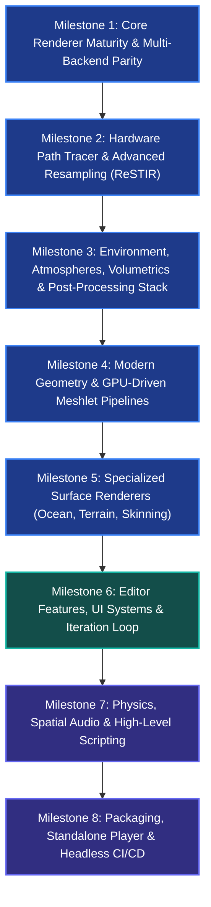

# Lyra Engine Roadmap Overview

This directory provides the comprehensive, low-level technical blueprint of remaining milestones and actionable tasks for **Lyra Engine**.

> [!IMPORTANT]
> **Priority Directive**: Graphics and rendering features take the highest precedence. Every rendering feature must have a corresponding **automated visual image test fixture** in `Tests/` with a golden `reference.png`, verified through perceptual regression testing ([`runtest.py`](file:///Users/tcheng/Repositories/Lyra-Engine/Tools/Scripts/runtest.py), enforcing RMSE $\le 2.0$, mismatch $\le 1.0\%$, and per-channel noise tolerance $\le 2$).

---

## 1. Architectural Layout (`Engine` vs. `Modules`)

Lyra uses a modular, plugin-centric architecture:
- **`Engine/`**: Interface contracts, orchestration logic, and engine runtime.
- **`Modules/`**: Interchangeable plugins implementing the contracts defined by `Engine/`.

```
Lyra-Engine/
├── Engine/
│   ├── Include/Lyra/
│   │   ├── Assets/          # Asset Management System (AMS) interfaces, registry, watcher, formats
│   │   ├── Compiler/        # Shader compiler interfaces (SLCTypes)
│   │   ├── Components/      # ECS components (Mesh, Light, Sun, Camera, Transform, Audio, Physics...)
│   │   ├── FileSystem/      # Virtual File System (VFSPath, VFSTypes)
│   │   ├── Graphics/        # RHI definitions (GPUDevice, GPUBuffer, GPUTexture, GPUCommandEncoder...)
│   │   ├── InputSystem/     # Input state, bindings, and device management
│   │   ├── JobSystem/       # Task scheduler, worker threads, and parallel dispatch
│   │   ├── Rendering/       # Frame Graph, RenderWorld extraction, GeometryCache, Builtin Passes
│   │   ├── Runtime/         # Application loop, AppContext (Services + Blackboard), Layers
│   │   ├── Scene/           # SceneTree hierarchy, SceneManager, EnTT integration
│   │   ├── Scripting/       # Scripting context, registry, and command queues
│   │   ├── UISystem/        # UI layout abstractions, widget wrappers (Tree, Dock, Gizmo, Dialog)
│   │   ├── Utilities/       # Foundation types, containers, math, pointers, sync, coroutines, logging
│   │   └── Windowing/       # Window System Interface (WSI) types and contracts
│   ├── Source/              # Core engine library implementation (lyra-engine)
│   └── Assets/Shaders/      # Unified Slang shaders (BSDF, Atmosphere, Volumetrics, Deferred, PathTracer, PostFX...)
│
└── Modules/
    ├── Assets/              # Cookers (glTF, OBJ, STL, DDS, KTX, EXR, Material, Mesh, Scene, Audio, Preview)
    ├── Compiler/            # Slang shader compiler, preprocessor, and reflection plugin
    ├── FileSystem/          # Native OS filesystem loader and PhysFS archive reader/packer
    ├── Graphics/            # RHI Backends: Vulkan, D3D12, Metal, SoftGPU (AVX2/Embree), MockGPU
    ├── Rendering/           # Renderers: Forward (Forward+), Deferred (Hybrid), GPUDriven, PathTracer
    ├── Scripting/           # Native & high-level scripting plugins (CameraControl, Lua/Luau)
    ├── UISystem/            # Dear ImGui backend, ImGuizmo integration, GUI Slang shader
    └── Windowing/           # GLFW desktop windowing backend
```

---

## 2. Master Milestone Roadmap



---

## 3. Milestone Index & Actionable Breakdowns

| Milestone Document | Scope & Key Focus Areas | Status |
| :--- | :--- | :--- |
| **[01. Core Renderer Maturity](file:///Users/tcheng/Repositories/Lyra-Engine/Roadmap/01_Core_Renderer.md)** | Multi-backend RHI parity audits, declarative pipeline serialization (`.pipeline`), driver PSO caching (`VkPipelineCache`/D3D12), offline Slang AOT shader pre-compilation & disk caching, per-renderer TOML configuration architecture, bindless descriptor indexing heap, FrameGraph transient VRAM aliasing, async compute queues, and GPU crash breadcrumbs. | Active |
| **[02. Path Tracer & ReSTIR Resampling](file:///Users/tcheng/Repositories/Lyra-Engine/Roadmap/02_Path_Tracer_ReSTIR.md)** | Delta tracking volumetric path tracing, ReSTIR DI (many-light direct lighting), ReSTIR GI (screen-space indirect reuse), ReSTIR PT (manifold shift mapping), and spatial hash radiance cache. | Active |
| **[03. Atmosphere & Volumetrics](file:///Users/tcheng/Repositories/Lyra-Engine/Roadmap/03_Atmosphere_Volumetrics.md)** | Unified 3D froxel-based volumetric fog, clustered in-scattering with CSM shadows, bilateral upsampling, 3D noise texture cooking, directional cloud shadows, screen-space motion vectors, and TAA / AMD FSR 2 temporal reconstruction. | Active |
| **[04. Geometry & GPU-Driven Meshlets](file:///Users/tcheng/Repositories/Lyra-Engine/Roadmap/04_Geometry_Meshlets.md)** | MikkTSpace tangent generation, `meshoptimizer` vertex/overdraw caching, meshlet clustering (`CHUNK_MSHL`), Task/Mesh shader amplification pipeline, and MultiDrawIndirect fallback. | Active |
| **[05. Specialized Surface Renderers](file:///Users/tcheng/Repositories/Lyra-Engine/Roadmap/05_Specialized_Surfaces.md)** | CDLOD quadtree terrain with tri-planar splatting, glTF skeletal mesh animation importer, and GPU bone palette linear blend / dual quaternion skinning. | Active |
| **[06. Editor Features & UI Systems](file:///Users/tcheng/Repositories/Lyra-Engine/Roadmap/06_Editor_UI.md)** | VS Code-style left Activity Bar (`ui::activity_bar`), collapsible primary sidebar (`Ctrl+B`), viewport shading selector, hierarchy reparenting and multi-selection, Add Component dropdown, live PBR material inspector, renderer TOML preset manager, centralized undo/redo command stack, GPU frame profiler, in-editor live shader diagnostic banner with jump-to-source, visual node-based Material Graph editor (`.matgraph`), dynamic C++ project extension live hot-reloading with shadow copying, and interactive in-editor Python REPL console. | Active |
| **[07. Physics, Audio & Scripting](file:///Users/tcheng/Repositories/Lyra-Engine/Roadmap/07_Physics_Audio_Scripting.md)** | Jolt physics debug wireframe pass, streamable binary audio asset cooker (`.audio`), Luau / Sol2 sandboxed script bindings, and Python ecosystem integration (`nanobind`, vectorized zero-copy EnTT buffer views, DLPack PyTorch tensor interop, and headless `import lyra` package mode). | Active |
| **[08. Packaging & Distribution](file:///Users/tcheng/Repositories/Lyra-Engine/Roadmap/08_Packaging_Distribution.md)** | Encapsulated runtime host & default plugins bundle (`EngineHost` / `DefaultPlugins`), shared `SceneRenderPipeline`, standalone application player executable (`Samples/Player`), headless GitHub Actions CI/CD with SoftGPU/MockGPU perceptual testing, `just lint` (`clang-tidy`), programmatic umbrella header generation (`just headers`), dynamic multi-extension project architecture (`ExtensionAPI`), modular library SDK distribution (`find_package(Lyra)`), and embedded Python / virtualenv packaging. | Active |

---

## 4. Visual Test Verification Standard

For every rendering milestone (Milestones 1 through 5):
1. **Dedicated Fixture in `Tests/`**: Every renderer feature must have a corresponding test target with `main.cpp`, `CMakeLists.txt`, and a canonical golden `reference.png`.
2. **Perceptual Metrics**: Tests run through `runtest.py` enforcing:
   - **RMSE Threshold**: $\le 2.0$ across RGB color channels.
   - **Mismatch Threshold**: $\le 1.0\%$ total mismatched pixels.
   - **Pixel Tolerance**: $\le 2$ per-channel tolerance to accommodate floating-point variation between driver/hardware implementations.
3. **Execution Command**:
   ```bash
   just test <fixture_name>   # e.g., just test deferred_renderer_multilight, just test path_tracer
   ```
