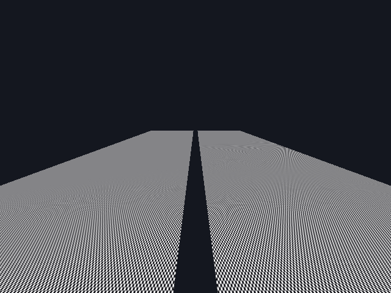

# Anisotropic Filtering Test

## Description
This test verifies anisotropic texture filtering (`GPUSamplerDescriptor::max_anisotropy`) compared against standard isotropic filtering when sampling high-frequency textures at grazing angles.

A $64 \times 64$ texture containing a fine alternating grid pattern with 7 complete mip levels (generated via $2 \times 2$ box filtering) is mapped onto two identical side-by-side ground planes receding from $z = 1.0$ to $z = -12.0$, viewed at a steep grazing angle:

- **Left Quad (Isotropic, `max_anisotropy = 1`)**: Standard isotropic filtering approximates the elongated elliptical pixel footprint with a symmetric circle, causing premature blurring and loss of longitudinal lines as the surface recedes into the distance.
- **Right Quad (Anisotropic, `max_anisotropy = 16`)**: Anisotropic filtering samples along the major axis of anisotropy, preserving crisp longitudinal lines and high-frequency details significantly deeper into the distance.

If anisotropic sampler configuration or device feature support is broken across backends, the right quad will blur identically to the left quad or trigger backend validation errors.

## Reference

