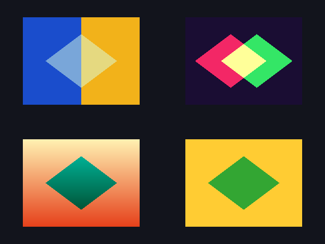

# Color & Alpha Blend Modes Test

## Description
This test validates color and alpha blend equations in the rasterization pipeline across four isolated quadrants framed on dark cards:

- **Top-Left (Standard Alpha Transparency)**: `SRC_ALPHA`, `ONE_MINUS_SRC_ALPHA`, `ADD`. A dual-split base card (Ocean Blue on the left half, Golden Amber on the right half) is overlaid with a translucent Mint-White diamond with $50\%$ alpha. Proper alpha transparency smoothly blends the diamond over both background colors without color distortion.
- **Top-Right (Additive Blending)**: `ONE`, `ONE`, `ADD`. Over a Midnight Violet background, two overlapping diamond emblems—one Coral Red (`#D91933`) and one Emerald Green (`#19D933`)—blend additively. Their intersection cleanly accumulates to a radiant Golden Yellow (`#F2F266`).
- **Bottom-Left (Multiplicative / Modulate Blending)**: `DST`, `ZERO`, `ADD`. A Sunset Gradient card (Crimson Orange at bottom to Warm Gold at top) is filtered through an Electric Cyan lens diamond. Multiplicative blending modulates incoming and destination channels, preserving green and blue components while filtering out deep reds into deep jade and olive tones.
- **Bottom-Right (Subtractive Blending)**: `ONE`, `ONE`, `REVERSE_SUBTRACT` ($\text{Dst} - \text{Src}$). Over a Radiant Amber-Orange card (`#CC9933`), a Crimson Coral diamond (`#CC2600`) subtracts its red component, cleanly revealing a deep Forest Jade Green (`#007333`) emblem in the difference.

If any blend factor, operation, or color attachment write mask is incorrectly handled or inverted, the resulting colors in each quadrant will drastically mismatch or expose raw saturated primaries.

## Reference

