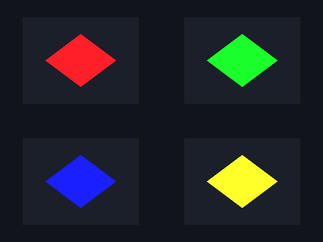

# Color Write Channel Masking Test

## Description
This test verifies selective color channel write masking in the rasterization pipeline using `GPUColorWriteFlags` across four isolated quadrants framed on dark cards:

- **Top-Left (Red Channel Mask)**: `GPUColorWrite::RED`. Over a Dark Navy Slate card (`#1A1F29` / `{0.10, 0.12, 0.16}`), a large diamond is rasterized with pure White `{1.0, 1.0, 1.0, 1.0}` vertex color. With only the Red channel write enabled, the Green and Blue channels remain preserved from the card, producing a radiant **Ruby Crimson** emblem (`#FF1F29`).
- **Top-Right (Green Channel Mask)**: `GPUColorWrite::GREEN`. A large White diamond is rasterized with only Green channel write enabled, producing a radiant **Emerald Green** emblem (`#1AFF29`).
- **Bottom-Left (Blue Channel Mask)**: `GPUColorWrite::BLUE`. A large White diamond is rasterized with only Blue channel write enabled, producing a radiant **Sapphire Blue** emblem (`#1A1FFF`).
- **Bottom-Right (Multi-Channel Mask)**: `GPUColorWrite::RED | GPUColorWrite::GREEN`. A large White diamond is rasterized with Red and Green channel writes enabled while Blue is masked out, producing a radiant **Golden Amber** emblem (`#FFFF29`).
- **Complete Write Suppression**: `GPUColorWrite::NONE`. Inside each of the four colored diamonds, an inner diamond is rasterized with pure Black `{0.0, 0.0, 0.0, 1.0}` vertex color using a pipeline configured with `GPUColorWrite::NONE`. Write suppression guarantees that zero color channels are updated, preserving the solid emblems without artifacts.

If color write masking is ignored or unimplemented by a backend, all four diamonds will render as raw flat White (`#FFFFFF`), or if write suppression fails, black diamond holes will puncture the center of each emblem.

## Reference

