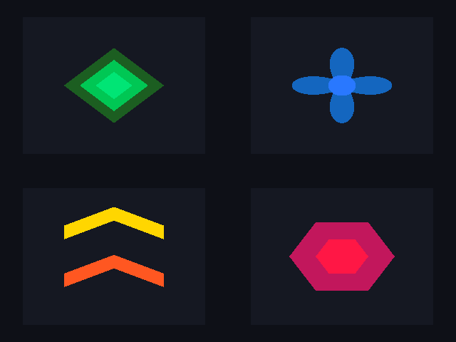

# Compute Indirect Dispatch Test

## Description
This test verifies GPU indirect compute dispatch execution (`cmd.dispatch_workgroups_indirect(indirect_buffer, offset)`) driven by a GPU buffer containing dispatch arguments (`DispatchIndirectArgs { uint32_t x, y, z }`) with a non-zero buffer offset.

The indirect buffer contains two sequential command records:
1. **Command 0 (Offset 0)**: A degenerate zero-dimension dispatch (`x = 0, y = 0, z = 0`). If the indirect dispatch offset is ignored or incorrectly bound to offset 0, no workgroups will execute and the output image will remain black/unrendered.
2. **Command 1 (Offset 12 / `sizeof(DispatchIndirectArgs)`)**: The actual dispatch arguments executing `(width + 31) / 32` by `(height + 31) / 32` workgroups of `32 x 32` threads across the full output surface.

The compute shader writes to a 2D storage image (`RWTexture2D<float4>`) across four quadrants on a dark slate canvas (`#0e1017`) and card backings (`#151822`):
- **Top-Left (Quadrant 0 - Concentric Diamond)**: Multi-tier diamond badge rendered via L1 Manhattan distance norm in **Mint** (`#00E676`), **Emerald** (`#00C754`), and **Dark Forest** (`#1C5E21`).
- **Top-Right (Quadrant 1 - Radiant Star)**: Polar harmonic modulation generating a 4-pointed radiant star in **Electric Blue** (`#2979FF`) and **Deep Sapphire** (`#1466BF`).
- **Bottom-Left (Quadrant 2 - Stacked Chevrons)**: Piecewise linear coordinate transformations creating stacked chevron emblems in **Amber Gold** (`#FFD600`) and **Sunset Coral** (`#FF5722`).
- **Bottom-Right (Quadrant 3 - Hexagonal Badge)**: Exact 2D hexagonal distance norm producing a concentric hexagon badge in **Bright Ruby** (`#FF1744`) and **Dark Magenta** (`#C2175B`).

If indirect compute dispatching, buffer offset calculation, command reading from device memory, or workgroup grid sizing is improperly implemented, the output will either fail to execute or produce artifacts.

## Reference

