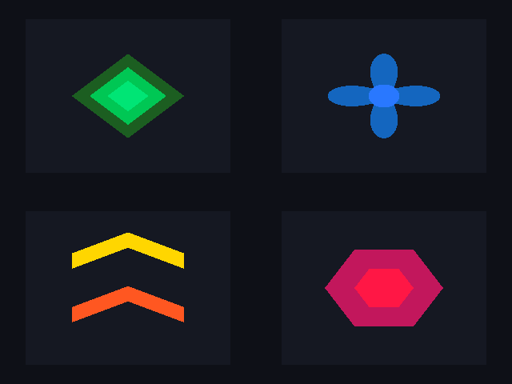

# Compute Storage Image Test

## Description
This test validates compute shader execution and direct writes to a 2D storage image (`RWTexture2D<float4>`) across workgroups, thread indexing (`SV_DispatchThreadID`), compute resource binding (`GPUResourceType::STORAGE_TEXTURE`), and image readback via `copy_texture_to_buffer`.

The compute shader operates on a 640x480 storage texture with a `[numthreads(16, 16, 1)]` threadgroup layout, procedurally rendering four distinct geometric badges onto quadrant cards:

- **Top-Left (Quadrant 0 - Concentric Diamond)**: Procedural L1 Manhattan distance field rendering a multi-tier concentric diamond emblem in **Mint** (`#00E676`), **Emerald** (`#00C754`), and **Dark Forest** (`#1C5E21`).
- **Top-Right (Quadrant 1 - Radiant Star)**: Polar harmonic modulation generating an 8-fold radial profile for a 4-pointed radiant star in **Electric Blue** (`#2979FF`) and **Deep Sapphire** (`#1466BF`).
- **Bottom-Left (Quadrant 2 - Stacked Chevrons)**: Piecewise linear coordinate transformations generating dual sharp stacked chevron emblems in **Amber Gold** (`#FFD600`) and **Sunset Coral** (`#FF5722`).
- **Bottom-Right (Quadrant 3 - Hexagonal Badge)**: Exact 2D hexagonal distance norm producing a concentric hexagonal badge in **Bright Ruby** (`#FF1744`) and **Dark Magenta** (`#C2175B`).

If compute shader compilation, storage texture binding, workgroup dispatching, threadgroup thread coordinate indexing, or storage texture data transfer is malfunctioning, the quadrants will be unrendered, corrupted, or completely black.

## Reference

