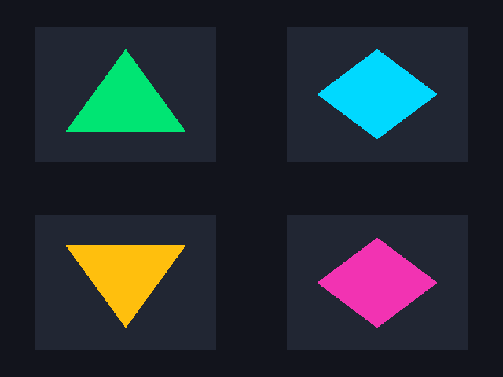

# Face Culling & Front-Face Winding Test

## Description
This test verifies primitive face culling (`cull_mode`: `NONE`, `FRONT`, `BACK`) and front-face winding (`front_face`: `CCW`, `CW`) in the rasterizer across four isolated quadrants framed on dark cards:

- **Top-Left (CCW Front Face)**: `front_face = CCW, cull_mode = BACK`. An upward-pointing triangle drawn in CCW order with backface culling. Because CCW is front-facing, it is not culled and renders as **Emerald Green**, overwriting a base red triangle.
- **Top-Right (CW Back Face Culling)**: `front_face = CCW, cull_mode = BACK`. A diamond motif where a CW red diamond is drawn on top of a **Cyan** diamond with backface culling. Because CW is back-facing, the red diamond is discarded by culling and the crisp Cyan diamond remains.
- **Bottom-Left (Inverted CW Front Face)**: `front_face = CW, cull_mode = BACK`. A downward-pointing triangle drawn in CW order. Because `front_face = CW`, the CW triangle is recognized as front-facing, is not culled, and renders as **Amber Gold**, overwriting a base red triangle.
- **Bottom-Right (Front-Face Culling)**: `front_face = CCW, cull_mode = FRONT`. A diamond motif where a CCW red diamond is drawn on top of a **Magenta** diamond with frontface culling. Because front-face culling is active, the front-facing CCW red diamond is discarded and the Magenta diamond remains.

When winding order and face culling work as expected, the test renders four distinct glowing geometric emblems (Emerald Green, Electric Cyan, Amber Gold, and Vivid Magenta) on dark cards. Any culling or winding failure causes the affected emblem to turn or be covered by bright Crimson Red.

## Reference

