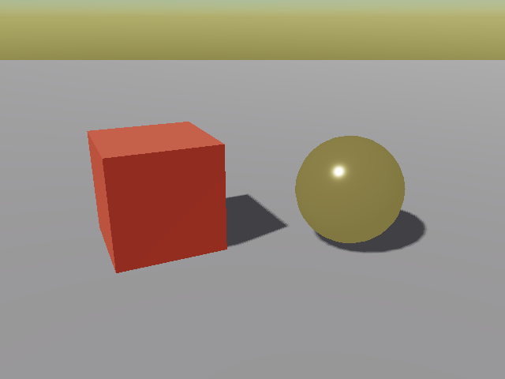

# Deferred Renderer Visual Test

## Description
This test exercises the Deferred renderer plugin (`lyra-deferred`),
rendering a procedural scene containing a cube, a sphere, and a floor plane.
Geometry is rasterized into multi-target G-Buffers (Albedo/Metallic, Normal/Roughness, Material Info, Depth),
followed by a deferred lighting resolve pass evaluating PBR BSDF and tonemapping.

## Reference

