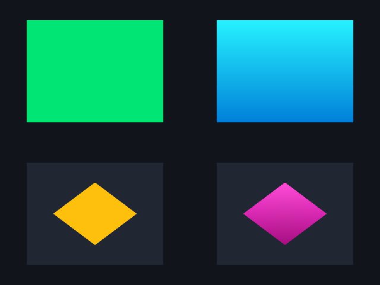

# Depth Bias Test

## Description
This test verifies constant depth bias and slope-scale depth bias in the rasterization pipeline across four isolated quadrants framed on dark cards:

- **Top-Left (Positive Constant Bias)**: `depth_bias = 8`. A flat **Emerald Green** card is drawn at $z = 0.5$, followed by an overlapping coplanar red diamond with positive constant bias. The bias pushes the red fragment deeper, causing it to fail the `LESS_EQUAL` depth test so the clean Emerald Green card remains.
- **Top-Right (Positive Slope-Scale Bias)**: `depth_bias_slope_scale = 2.0`. An **Electric Cyan** gradient card is drawn sloping in 3D from $z = 0.3$ (top) to $0.7$ (bottom), followed by an overlapping coplanar red diamond with positive slope bias. The bias pushes the red fragment deeper along the slope, failing the `LESS_EQUAL` depth test so the smooth Cyan gradient card remains.
- **Bottom-Left (Negative Constant Bias)**: `depth_bias = -8`. A dark slate card with a base red diamond at $z = 0.5$, followed by an overlapping **Amber Gold** diamond with negative constant bias. The negative bias pulls the Amber Gold fragment closer, passing the `LESS` depth test and crisply overwriting the red diamond.
- **Bottom-Right (Negative Slope-Scale Bias)**: `depth_bias_slope_scale = -2.0`. A dark slate card with a base red diamond sloping from $z = 0.3$ to $0.7$, followed by an overlapping **Vivid Magenta** gradient diamond with negative slope bias. The negative bias pulls the Magenta fragment closer along the slope, passing the `LESS` depth test and crisply overwriting the red diamond.

When depth bias and slope scaling work as expected, all four quadrants render with distinct colors and depth-shaded emblems (Emerald Green, Electric Cyan gradient, Amber Gold, and Vivid Magenta gradient) on dark cards. Any failure in depth bias computation leaves glaring Crimson Red exposed.

## Reference

