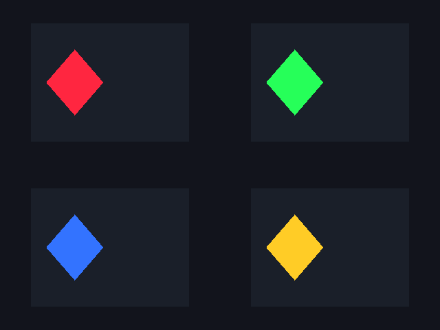

# Depth Compare Operations Test

## Description
This test verifies depth comparison functions in the rasterization pipeline across four isolated quadrants framed on dark cards:

- **Top-Left (LESS Test)**: `GPUCompareFunction::LESS`. Over a Dark Navy Slate card drawn at depth $z = 0.5$, a left diamond at $z = 0.3$ ($0.3 < 0.5$) passes the depth test and renders as **Ruby Crimson** (`#FF2640`). An attempted right diamond at $z = 0.7$ ($0.7 \not< 0.5$) fails and is discarded.
- **Top-Right (GREATER Test)**: `GPUCompareFunction::GREATER`. Over a card at $z = 0.5$, a left diamond at $z = 0.7$ ($0.7 > 0.5$) passes the depth test and renders as **Emerald Green** (`#26FF59`). An attempted right diamond at $z = 0.3$ ($0.3 \not> 0.5$) fails and is discarded.
- **Bottom-Left (EQUAL Test)**: `GPUCompareFunction::EQUAL`. Over a card at $z = 0.5$, a left diamond at exact depth $z = 0.5$ ($0.5 == 0.5$) passes the depth test and renders as **Sapphire Blue** (`#3373FF`). An attempted right diamond at $z = 0.6$ ($0.6 \neq 0.5$) fails and is discarded.
- **Bottom-Right (ALWAYS vs NEVER Test)**: `GPUCompareFunction::ALWAYS` vs `NEVER`. Over a card at $z = 0.5$, a left diamond at $z = 0.9$ ($0.9 > 0.5$) unconditionally passes via `ALWAYS` and renders as **Radiant Amber Gold** (`#FFCC26`). An attempted right diamond at $z = 0.1$ ($0.1 < 0.5$) is unconditionally rejected via `NEVER`.

If any depth comparison operator is broken or inverted across backends, the wrong diamond will render or emblems will disappear entirely.

## Reference

