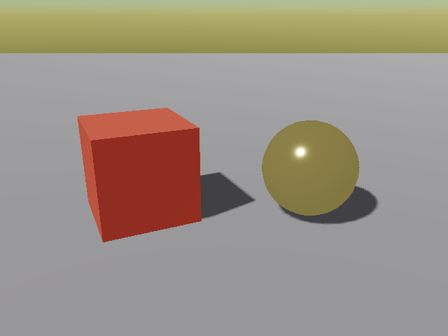

# Forward / Forward+ Renderer Visual Test

## Description
This test exercises the Forward / Forward+ renderer plugin (`lyra-forward`),
rendering a procedural scene containing a cube, a sphere, and a floor plane illuminated
by a directional sun light with cascaded shadow mapping, depth prepass, atmospheric sky,
and clustered lighting.

## Reference

