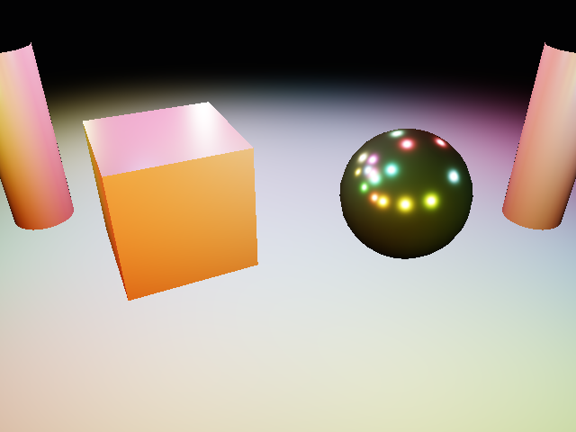

# Forward+ Renderer Multi-Light Stress Test

## Description
This test exercises the clustered multi-light Forward+ rendering pipeline in `lyra-forward`.
The test chamber features a procedural cube, sphere, ground plane, and two shadow-casting occluder pillars.
Direct sunlight is disabled to amplify and isolate the influence of local illumination.
16 colored point lights with smooth quadratic-quartic distance attenuation are arranged at varying elevations and angles to generate vivid, distinct Cook-Torrance GGX specular highlights across the cube's top, front, and side faces as well as the sphere.

Lighting parameters:
- **Directional Light**: Disabled (`intensity = 0.0`)
- **Point Lights**: 16 active colored point lights with multi-tier elevation ($y \in [0.9, 1.9]$)
- **Occluders**: 2 procedural cylinders positioned as shadow and light occluders
- **Shading**: Clustered light culling compute pass followed by forward rasterization pass evaluating analytical PBR attenuation across clusters

## Reference

