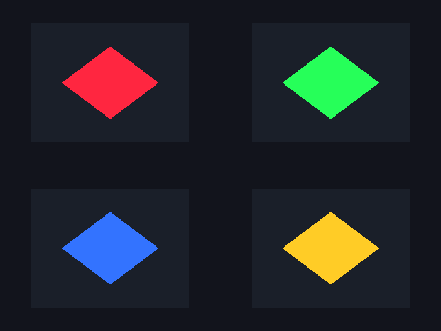

# Index Formats and Base Vertex Offsets Test

## Description
This test verifies index buffer formats (`GPUIndexFormat::UINT16` and `GPUIndexFormat::UINT32`), index offsets (`first_index`), base vertex offsets (`base_vertex`), and buffer byte offsets in `set_index_buffer` across four isolated quadrants:

- **Top-Left (UINT16, Standard Offsets)**: A `UINT16` index buffer with standard zero offsets (`first_index = 24`, `base_vertex = 0`, `offset = 0`) draws a **Ruby Red** diamond emblem over a Dark Slate card.
- **Top-Right (UINT32, Non-Zero First Index)**: A `UINT32` index buffer with 6 dummy padding indices draws an **Emerald Green** diamond emblem using `first_index = 6` (`draw_indexed(6, 1, 6, 0, 0)`).
- **Bottom-Left (UINT16, Non-Zero Base Vertex)**: A `UINT16` index buffer containing local relative indices `(0, 1, 2, 0, 2, 3)` draws a **Sapphire Blue** diamond emblem using `base_vertex = 24` (`draw_indexed(6, 1, 30, 24, 0)`).
- **Bottom-Right (Buffer Byte Offset & Base Vertex)**: The index buffer is bound with a non-zero byte offset `42 * sizeof(uint16_t)` in `set_index_buffer`, drawing an **Amber Gold** diamond emblem with local indices and `base_vertex = 28` (`draw_indexed(6, 1, 0, 28, 0)`).

If index type decoding (16-bit vs 32-bit), `base_vertex` addition, `first_index` index stride calculation, or index buffer bind byte offset is broken or unsupported, diamonds will be displaced, deformed, or fail to render.

## Reference

