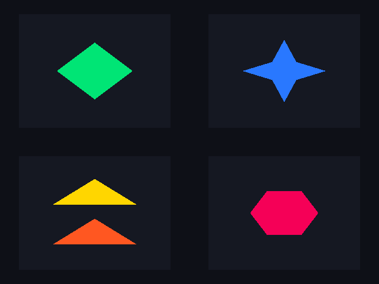

# Indirect Drawing Test

## Description
This test verifies GPU buffer-driven execution via `draw_indirect` and `draw_indexed_indirect`, supporting multi-draw indirect commands (`draw_count > 1`) and non-zero indirect buffer byte offsets across four isolated quadrants:

- **Top-Left (draw_indirect, Single Draw, Offset 0)**: A single non-indexed draw command read from `indirect_vbuffer` at offset 0 (`draw_count = 1`) renders an **Emerald Green** Diamond emblem (`vertex_count = 6`).
- **Top-Right (draw_indexed_indirect, Single Draw, Base Vertex)**: An indexed indirect draw command read from `indirect_ibuffer` at offset 0 (`draw_count = 1`) renders a **Sapphire Blue** 4-pointed Star emblem (`index_count = 24`, `first_index = 0`, `base_vertex = 6`).
- **Bottom-Left (draw_indirect, Multi-Draw Indirect)**: Two contiguous draw commands read from `indirect_vbuffer` at byte offset 16 (`sizeof(DrawIndirectArgs)`) with `draw_count = 2` render two stacked Chevrons in a single indirect dispatch:
  - Command 1: **Amber Gold** Upper Chevron (`first_vertex = 15`).
  - Command 2: **Sunset Coral** Lower Chevron (`first_vertex = 21`).
- **Bottom-Right (draw_indexed_indirect, Non-Zero Offset & Base Vertex)**: An indexed indirect draw command read from `indirect_ibuffer` at byte offset 20 (`sizeof(DrawIndexedIndirectArgs)`) renders a **Ruby Magenta** Hexagon badge (`index_count = 18`, `first_index = 24`, `base_vertex = 27`).

If indirect argument buffer reading, indirect stride stride calculation, multi-draw loop, or indexed indirect parameter unpacking (`base_vertex`, `first_index`) is broken or unsupported, emblems will be missing, misplaced, or fail to render.

## Reference

