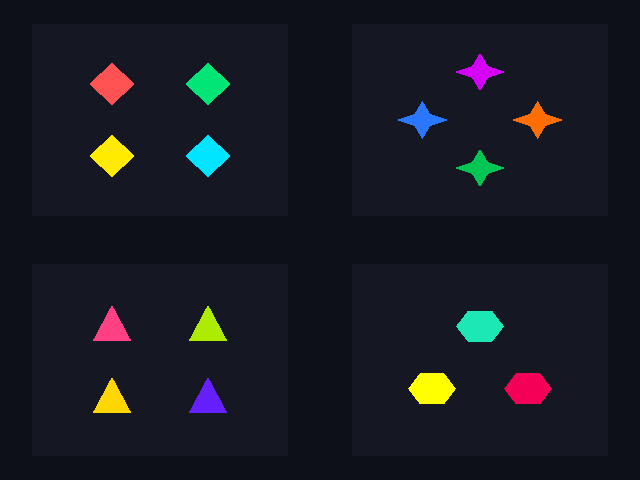

# Instanced Drawing Test

## Description
This test verifies instanced rendering capabilities across multiple vertex buffers with `GPUVertexStepMode::VERTEX` and `GPUVertexStepMode::INSTANCE` step modes, non-indexed instanced draw (`draw`), indexed instanced draw (`draw_indexed`), instance position offsets, per-instance colors, and instance index offsets across four isolated quadrants:

- **Top-Left (Non-Indexed Instanced Draw)**: A base diamond mesh in slot 0 (`step_mode = VERTEX`) is drawn with `instance_count = 4` and `first_instance = 0` via `draw(6, 4, 0, 0)`. Four instances are arranged in a 2x2 grid using per-instance position offsets and distinct instance colors (Coral, Mint, Gold, Cyan) supplied from slot 1 (`step_mode = INSTANCE`).
- **Top-Right (Indexed Instanced Draw with Base Vertex)**: A base indexed 4-pointed star geometry (`index_count = 24`, base vertex 6) is drawn with `instance_count = 4` and `first_instance = 4` via `draw_indexed(24, 4, 0, 6, 4)`. Four instances form a diamond constellation with distinct colors (Purple, Electric Blue, Neon Orange, Emerald).
- **Bottom-Left (Non-Indexed Instancing with Non-Zero First Instance)**: A base arrow pennant geometry (`first_vertex = 15`) is drawn with `instance_count = 4` using non-zero `first_instance = 8` (`draw(3, 4, 15, 8)`). Verifies that `first_instance` correctly offsets into the instance buffer, rendering 4 distinct instances (Pink, Lime, Amber, Violet).
- **Bottom-Right (Indexed Instancing with First Index, Base Vertex, and First Instance)**: An indexed hexagon badge (`index_count = 18`, `first_index = 24`, `base_vertex = 18`) is rendered with `instance_count = 3` and `first_instance = 12` via `draw_indexed(18, 3, 24, 18, 12)`, forming an inverted triad (Turquoise, Yellow, Ruby).

If vertex step rate selection (`VERTEX` vs `INSTANCE`), instance count loop, `first_instance` offset arithmetic, or per-instance attribute binding is broken, emblems will appear singly, overlap at the origin, fail to render, or display corrupt colors.

## Reference

