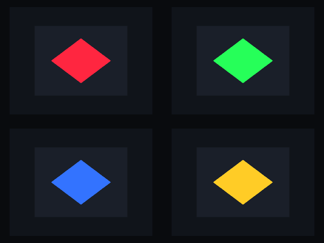

# Multiple Render Targets (MRT) Test

## Description
This test verifies pipeline multi-render target (MRT) rendering with 4 simultaneous color attachments (`SV_Target0..3`) in a single render pass, followed by a composite blit pass presenting all 4 targets into a 4-quadrant layout:

- **Pass 1 (MRT Pass)**: A single draw call simultaneously outputs to 4 offscreen render targets:
  - **Target 0 (`SV_Target0`)**: Base Albedo / **Ruby Red** (`#FF2640`) emblem on Dark Slate card.
  - **Target 1 (`SV_Target1`)**: Normal Vector Field / **Emerald Green** (`#26FF59`) emblem on Dark Slate card.
  - **Target 2 (`SV_Target2`)**: Material Properties / **Sapphire Blue** (`#3373FF`) emblem on Dark Slate card.
  - **Target 3 (`SV_Target3`)**: Emissive Map / **Amber Gold** (`#FFBF26`) emblem on Dark Slate card.
- **Pass 2 (Composite Pass)**: Samples the 4 offscreen render targets and maps them to the screen:
  - **Top-Left (Quadrant 0)**: Displays Target 0 (Ruby Red).
  - **Top-Right (Quadrant 1)**: Displays Target 1 (Emerald Green).
  - **Bottom-Left (Quadrant 2)**: Displays Target 2 (Sapphire Blue).
  - **Bottom-Right (Quadrant 3)**: Displays Target 3 (Amber Gold).

If multi-attachment output routing, attachment index binding, or texture layout transitions are broken, individual quadrants will render black or show incorrect attachment data.

## Reference

