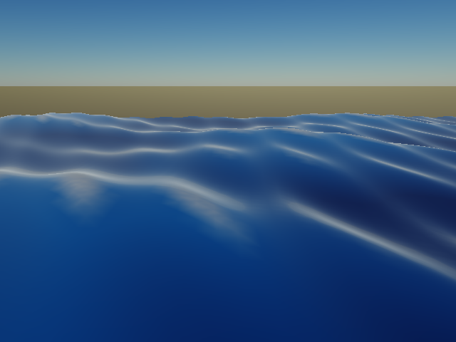

# Ocean Surface Rendering Test

Verifies specialized surface rendering for ocean and water surfaces (Milestone 5, Task 5.2):
- **Gerstner Wave Displacement**: 4-harmonic wave synthesis with dynamic horizontal vertex displacement and analytical surface normal, tangent, and bitangent evaluation.
- **Physical Water Optics**: Snell-Fresnel dielectric reflection and transmission splitting ($n = 1.333$).
- **Sun Specular Glint**: Microfacet Cook-Torrance GGX specular highlights with Smith masking-shadowing along the sun reflection path.
- **Atmospheric Reflection**: Environmental sky radiance gradient from horizon haze to deep zenith blue.
- **Underwater Light Absorption**: Beer-Lambert spectral transmission attenuation through the water column and wave crest forward scattering.
- **Dynamic Foam Caps**: Crest sharpening foam accumulation triggered by negative Jacobian conditions ($J < 0$) modulated by high-frequency procedural noise.

