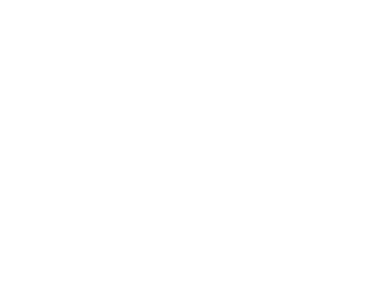

# Path Tracer

## Description
Reference hardware-accelerated Monte Carlo path tracer rendering the classic Cornell Box with stationary multi-frame temporal accumulation, BSDF importance sampling, and Next-Event Estimation (NEE).

## Reference

