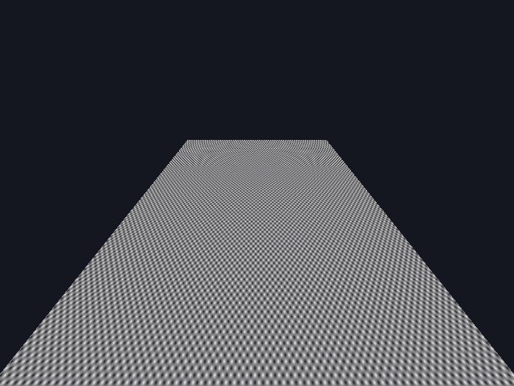

# Perspective Correction Test

## Description
This test verifies perspective-correct attribute interpolation during triangle rasterization.

A textured quad composed of two triangles is placed on the ground plane receding into the distance from $z = 1.0$ (near the camera) to $z = -7.0$ (far from the camera) and rendered using a perspective projection matrix ($\text{FOV} = 60^\circ$):

- The quad is textured with a repeating $16 \times 16$ high-contrast checkerboard pattern ($8 \times 8$ repetitions across the quad).
- With perspective-correct interpolation ($u/w, v/w, 1/w$), grid lines remain perfectly straight as they converge toward the perspective vanishing point, and the diagonal edge dividing the two triangles is completely seamless and undetectable.
- If perspective correction is missing or flawed (e.g. screen-space affine linear interpolation), the checkerboard tiles will exhibit severe distortion and a prominent diagonal kink along the shared triangle seam.

## Reference

