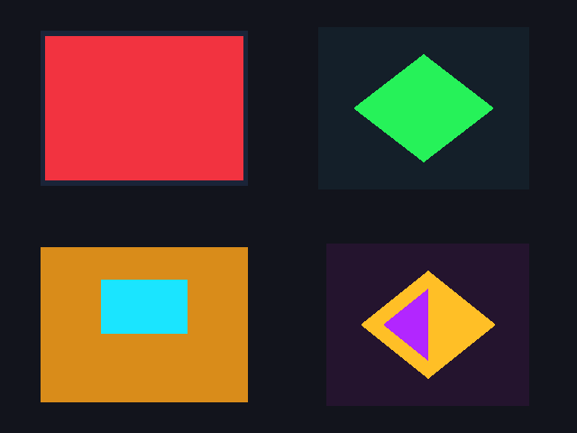

# Scissor Rect & Viewport Clipping Test

## Description
This test verifies dynamic scissor rectangle clipping and sub-viewport mapping in the rasterization pipeline across four isolated quadrants:

- **Top-Left (Inset Scissor Box)**: Over a Navy Slate card (`#1A2338`), the scissor rectangle is restricted to an inset box `(50, 40, 220, 160)`. An oversized **Crimson Coral** (`#F23340`) quad covering the entire quadrant is drawn; scissor clipping strictly confines the crimson quad to the inner window, leaving a clean navy border around it.
- **Top-Right (Sub-Viewport Mapping)**: `set_viewport(340, 20, 260, 200)` and `set_scissor_rect(340, 20, 260, 200)`. Geometry defined in normalized $[-1, 1]$ coordinates (a Slate card and an **Emerald Green** `#26F259` diamond) correctly projects into the top-right sub-viewport tile.
- **Bottom-Left (Horizontal Scissor Stripe)**: Over a Sunset Gold card (`#D98C1A`), the scissor is set to a narrow letterbox stripe `(45, 310, 230, 60)`. An oversized vertical **Electric Cyan** (`#1AE6FF`) quad is drawn; scissor clipping transforms it into a sharp horizontal band across the gold card.
- **Bottom-Right (Sub-Viewport with Split Scissor)**: `set_viewport(350, 260, 250, 200)` maps a Plum card and a **Radiant Amber** (`#FFBF26`) diamond into the tile. The scissor rectangle is then narrowed to the left half `(350, 260, 125, 200)`, and an inner **Vivid Violet** (`#B326FF`) diamond is drawn; scissor clipping splits the violet diamond down the middle.

If scissor clipping or viewport transformation is ignored, inverted, or offset across backends, geometries will overflow their quadrant bounds or vanish entirely.

## Reference

