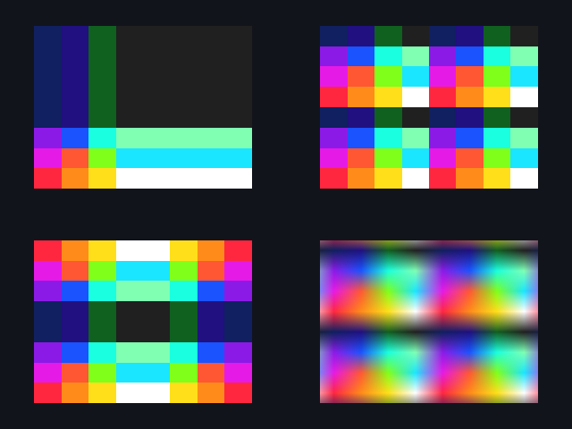

# Sampler Addressing and Filter Modes Test

## Description
This test verifies sampler address wrapping modes (`GPUAddressMode::CLAMP_TO_EDGE`, `REPEAT`, and `MIRROR_REPEAT`) and filtering modes (`GPUFilterMode::NEAREST` and `LINEAR`) with UV coordinates mapped across $[0.0, 2.0] \times [0.0, 2.0]$ over a high-contrast $4 \times 4$ multi-color texel pattern across four isolated quadrants:

- **Top-Left (CLAMP_TO_EDGE, NEAREST)**: The $4 \times 4$ pattern occupies UV $[0, 1]$, and coordinates in $[1, 2]$ clamp to the border texels, creating solid horizontal and vertical edge streaks.
- **Top-Right (REPEAT, NEAREST)**: The $4 \times 4$ pattern tiles seamlessly into a $2 \times 2$ grid with crisp nearest-neighbor texel boundaries.
- **Bottom-Left (MIRROR_REPEAT, NEAREST)**: The pattern repeats with alternating axis reflections, forming a mirrored kaleidoscopic $2 \times 2$ grid.
- **Bottom-Right (REPEAT, LINEAR)**: The pattern tiles in a $2 \times 2$ grid with smooth bilinear filtering across texel boundaries and wrapped edge transitions.

If address wrapping calculations, border clamping, or bilinear texel neighbor lookups are incorrect across backends, tiles will fail to repeat, clip to black, show discontinuous borders, or misalign texel filtering.

## Reference

