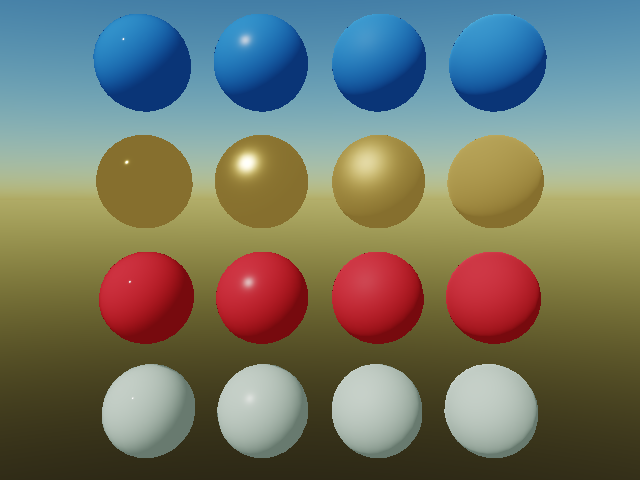

# Shading Models Visual Regression Test

## Description
This test exercises Lyra's unified shading models (`Standard`, `Clearcoat`, `Subsurface`, and `Unlit`),
rendering a $4 \times 4$ sphere matrix varying in roughness, metallic, clearcoat, and subsurface scattering properties:
- **Row 0**: Standard PBR dielectric spheres ($metallic = 0.0$, roughness $0.05 \to 0.95$).
- **Row 1**: Standard PBR metallic spheres ($metallic = 1.0$, roughness $0.05 \to 0.95$).
- **Row 2**: Clearcoat spheres ($clear\_coat = 1.0$, base roughness $0.05 \to 0.85$).
- **Row 3**: Subsurface spheres with organic and translucent diffusion.

## Reference

