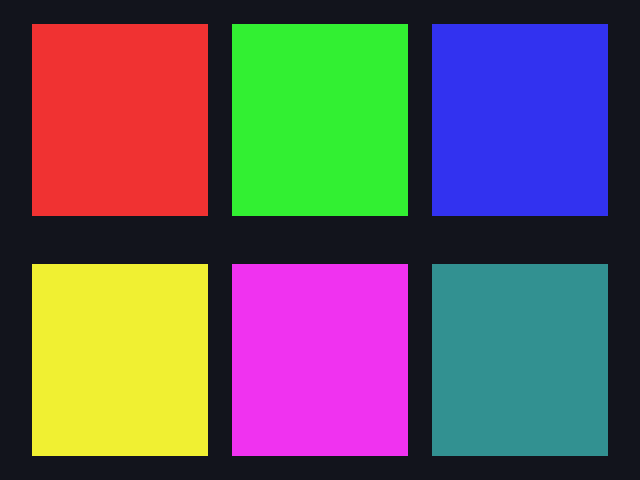

# Texture Level of Detail (LOD) Test

## Description
This test verifies multi-level texture mipmap allocation, multi-mip resource barrier transitions, explicit shader `SampleLevel()` lookups, and trilinear mip filtering (`GPUMipmapFilterMode::LINEAR`).

A $32 \times 32$ texture is created with 6 distinct mip levels, each painted with a distinct solid color:
- **Mip 0 ($32 \times 32$)**: Coral Red (`#F03232`)
- **Mip 1 ($16 \times 16$)**: Emerald Green (`#32F032`)
- **Mip 2 ($8 \times 8$)**: Sapphire Blue (`#3232F0`)
- **Mip 3 ($4 \times 4$)**: Sunflower Yellow (`#F0F032`)
- **Mip 4 ($2 \times 2$)**: Vivid Magenta (`#F032F0`)
- **Mip 5 ($1 \times 1$)**: Electric Cyan (`#32F0F0`)

The screen is partitioned into 6 distinct panels displaying explicit LOD sampling:
- **Top-Left**: Explicit LOD = 0.0 (displays pure Mip 0 - Red).
- **Top-Center**: Explicit LOD = 1.0 (displays pure Mip 1 - Green).
- **Top-Right**: Explicit LOD = 2.0 (displays pure Mip 2 - Blue).
- **Bottom-Left**: Explicit LOD = 3.0 (displays pure Mip 3 - Yellow).
- **Bottom-Center**: Explicit LOD = 4.0 (displays pure Mip 4 - Magenta).
- **Bottom-Right**: Explicit fractional LOD = 1.5, verifying trilinear interpolation by smoothly blending 50% Mip 1 (Green) and 50% Mip 2 (Blue).

If subresource barrier transitions, mip level copying, or shader `SampleLevel` lookups are incorrect across backends, tiles will fail to display the corresponding mip level, show black/corrupted texels, or fail trilinear blending.

## Reference

